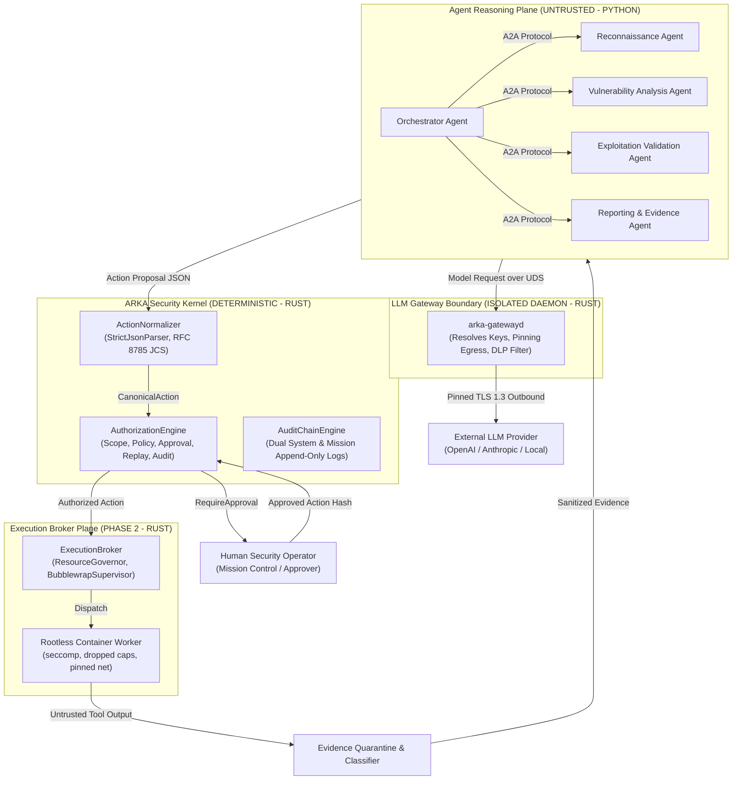

# ARKA Phase 3 — Intelligence & Multi-Agent Plane Architecture Plan

**Status:** PROPOSED Architecture Plan (Ready for Human CODEOWNER Ratification)  
**Repository:** https://github.com/jivi001/ARKA  
**Governing Documents:** ARKA PRD v2.2, ARKA TRD v2.2, `AGENTS.md`  
**Verified Baseline:** Commit `abf6da7b005e7ed8b49991c00667eb6242d00d6e` on `feat/p2-execution-plane`  
**Date:** 2026-10-18  
**Classification:** Security Architecture & Implementation Blueprint  

---

## 1. Executive Summary & Operating Invariants

Phase 3 establishes the Intelligence and Multi-Agent Reasoning Plane of the ARKA platform. While Phase 1 delivered the deterministic Rust Security Kernel and Phase 2 constructed the sandboxed Execution Broker and network-policy enforcement boundaries, Phase 3 introduces autonomous AI reasoning loops, structured multi-agent coordination, prompt-injection defenses, and external LLM provider integrations.

Autonomous operations are governed by non-negotiable architectural invariants:

$$\mathbf{DISCOVERED \neq AUTHORIZED}$$

1. **INV-001 (LLM Zero Execution Authority):** Natural language models have zero direct OS, socket, shell, or execution authority. LLMs propose structured actions; the deterministic Rust Security Kernel authorizes; the Execution Broker dispatches.
2. **INV-002 (Agent Zero Execution Authority):** Agents possess zero target-facing execution capabilities. All side effects flow through the single broker path.
3. **INV-004 (Child Monotonicity):** Sub-delegated child agent authority cannot exceed parent authority across capabilities, risk classes, budget ceilings, expiry, or mission scope.
4. **INV-005 (Approval Parameter Binding):** Human operator approvals bind byte-for-byte to the canonical action hash. Any mutation invalidates approval.
5. **INV-007 (Target Data Is Untrusted):** Ingested web responses, DNS records, terminal outputs, and OSINT findings are untrusted data and must never be interpreted as execution commands.
6. **INV-008 & INV-009 (Single Execution Path & No Parallel Authority):** All side effects must flow through the Rust Execution Broker. No secondary execution path may exist for LLM function calling or automated workflows.
7. **INV-010 (Fail Closed):** Any authentication failure, cryptographic invalidity, schema violation, or policy denial results in immediate operation termination.
8. **INV-011 (Provider Credential Isolation):** LLM provider API credentials must be resolved exclusively by the isolated LLM Gateway and must never enter agent context, evidence, audit, memory, action proposals, or logs.
9. **INV-012 (Provider Credential Has No ARKA Authority):** An LLM provider credential grants inference access only and confers zero ARKA authorization or execution capability.

---

## 2. Objective and Scope

### 2.1 In Scope for Phase 3

1. **Standalone LLM Gateway Daemon (`COMP-LLM-GW` / `arka-gatewayd`):** Dedicated process isolating provider secrets, enforcing endpoint-pinned network egress via Phase 2 `DirectIpConnector`, and applying outbound data-loss prevention (DLP).
2. **Agent-to-Agent (A2A) Cryptographic Protocol (`COMP-AUTH`):** Strongly typed, versioned wire message contract enforcing sender/recipient binding, mission isolation, temporal validity ($\le 60\text{s}$), and replay rejection.
3. **Unified Action Normalization Boundary (`COMP-KERNEL`):** Routing direct agent proposals and native LLM tool calls through the single authoritative `ActionNormalizer` using RFC 8785 JSON Canonicalization Scheme (JCS).
4. **Dual-Boundary Prompt Injection Defense (`COMP-LLM-GW` / `COMP-AGENTS`):** Nonce-delimited structured data framing and target content quarantine ensuring prompt injection cannot escape data contexts or forge actions.
5. **Quarantined Evidence Ingestion & Classification Pipeline (`COMP-EVID`):** Safe parser sandboxing for complex artifacts (HTML, XML, JSON), terminal ANSI stripping, and deterministic multi-level trust and sensitivity classification.
6. **Multi-Agent Role Taxonomy & Delegation:** Role-specific capability restrictions for Orchestrator, Reconnaissance, Vulnerability Analysis, Exploitation Validation, and Reporting agents.
7. **Knowledge Graph Assertion Provenance Binding (`COMP-KG`):** Enforcing cryptographic evidence pointers (`evidence_hash`) for all graph assertions to prevent unverified RAG/graph poisoning.

### 2.2 Explicitly Out of Scope for Phase 3

- Target credential vaulting and ephemeral session injection (deferred to Phase 6: Credential Vault & Session Broker).
- Hardware virtualization / microVM / Firecracker isolation for high-risk exploitation (deferred to Phase 9: Strong Virtualization Isolation).
- Windows worker execution (deferred to Windows worker phase).
- Enabling live production exploitation capabilities (`CONTROLLED_EXPLOITATION` remains disabled until Phase 6 & Phase 9 are ratified).

---

## 3. Architecture Topology and Trust Boundaries



### 3.1 Primary Trust Boundaries

1. **TB-01: Agent Plane $\leftrightarrow$ Kernel Boundary:** Communication is strictly one-way structured JSON action proposals. The kernel rejects invalid payloads, enforces scope, checks emergency stop status, and derives risk authoritatively.
2. **TB-02: Agent Plane $\leftrightarrow$ LLM Gateway Boundary:** Unix Domain Socket with kernel-verified `SO_PEERCRED`. Agents transmit prompt text and receive model responses; agents never receive or inspect provider credentials.
3. **TB-03: Gateway $\leftrightarrow$ External LLM Provider Boundary:** Outbound network connection strictly pinned via `DirectIpConnector` and encrypted via TLS 1.3. Outbound payloads are inspected by DLP filters before transmission.
4. **TB-04: Worker Container $\leftrightarrow$ Evidence Pipeline Boundary:** Raw stdout/stderr and target files are treated as hostile; stripped of ANSI control sequences and parsed within unprivileged memory-limited sandboxes.

---

## 4. Component Layout: Existing vs. Planned

```text
ARKA Workspace Architecture
├── crates/
│   ├── arka-core-types/          # [EXISTING] Base types, IDs, CanonicalAction, RawActionProposal
│   │   └── src/a2a.rs            # [PLANNED - P3-B] Strongly typed A2A envelope & payload models
│   ├── arka-crypto/              # [EXISTING] StrictJsonParser, canonicalize_json (JCS), SignedToken
│   ├── arka-kernel/              # [EXISTING] ActionNormalizer, CapabilityRegistry, ScopeEngine, AuthEngine
│   ├── arka-storage-sqlite/      # [EXISTING] SQLite WAL persistence, atomic replay log
│   ├── arka-execution-broker/    # [EXISTING] ExecutionBroker, BubblewrapSupervisor, Governor
│   ├── arka-network-policy/      # [EXISTING] DirectIpConnector, ScopeGuard, RedirectPolicy
│   ├── arka-worker-protocol/     # [EXISTING] Worker framing and execution contracts
│   └── arka-gateway/             # [PLANNED - P3-C] Standalone Rust Gateway daemon (arka-gatewayd)
│       ├── src/server.rs         # Authenticated UDS IPC server (SO_PEERCRED)
│       ├── src/dlp.rs            # Outbound secret & token filtering
│       ├── src/pinning.rs        # Pinned DNS resolution & TLS dialing
│       └── src/adapters/         # Provider adapters (OpenAI, Anthropic, Ollama)
├── arka/                         # [PYTHON INTELLIGENCE PLANE]
│   ├── core/
│   │   ├── crypto/provider.py    # [EXISTING] DevelopmentKeyProvider
│   │   ├── crypto/canonical.py   # [PLANNED - P3-B] Verified RFC 8785 JCS implementation
│   │   ├── a2a/                  # [PLANNED - P3-C] A2A transport, envelope parsing, replay cache
│   │   └── evidence/             # [PLANNED - P3-D] Evidence quarantine, parser sandbox, classifier
│   ├── gateway/client.py         # [PLANNED - P3-C] UDS client communicating with arka-gatewayd
│   └── agents/                   # [PLANNED - P3-D] Autonomous agent role implementations
│       ├── base.py               # Base reasoning loop with dual-boundary framing
│       ├── orchestrator.py       # Mission decomposition & subtask delegation
│       ├── recon.py              # Perimeter discovery & scope exploration
│       ├── vuln_analysis.py      # Fingerprinting & service analysis
│       ├── exploit_val.py        # Safe PoC verification (Approval-Gated)
│       └── reporting.py          # Evidence synthesis & narrative generation
├── docs/security/
│   ├── adr/                      # [EXISTING: ADR-001..003 | PLANNED: ADR-004..006]
│   ├── PHASE_3_ARCHITECTURE_PLAN.md
│   └── OWASP_LLM_TOP_10_PHASE_3_TRACEABILITY.md
└── security/                     # Security model, acceptance gates, tests, traceability
```

---

## 5. Credential Architecture and Key Management

Key management adheres strictly to [`security/keys/key-management-policy.yaml`](file:///home/exu0/cybersecurity/Programs/ARKA/security/keys/key-management-policy.yaml):

1. **`TOKEN-SIGNING` Domain (Rust Security Kernel):** Authoritative Ed25519 keypair sealing ephemeral capability tokens (`SignedToken`). Key never leaves kernel memory; rotated every 24 hours.
2. **`AUDIT-SIGNING` Domain (Audit Service):** Ed25519 keypair signing append-only dual audit logs. Isolated in audit service.
3. **`WORKER-IDENTITY` Domain (Execution Broker):** Ephemeral mTLS keypairs generated per container task.
4. **`LLM-PROVIDER-CREDENTIALS` (LLM Gateway Exclusive):** API keys resolved by `arka-gatewayd` from OS keyring, KMS, or development `.env`. Completely quarantined from Python agents.
5. **`A2A-MESSAGE-SIGNING` Domain:** Agent identity keypairs for inter-agent mutual authentication (governed by ADR-005).

---

## 6. Implementation Checkpoints & Phased Delivery

To maintain deterministic security guarantees, Phase 3 is executed across four sequential checkpoints:

```text
Phase 3 Execution Flow:
[P3-A: Architecture Lock] ──► [P3-B: Schemas & JCS] ──► [P3-C: Gateway & A2A] ──► [P3-D: Agents & Quarantine]
```

### Checkpoint P3-A — Architecture Lock & Governance Ratification
- **Objective:** Finalize all Phase 3 architectural decisions and governance prerequisites without modifying runtime code.
- **Deliverables:**
  - `ADR-004` (Gateway Topology, Credential Isolation, and Pinned Egress).
  - `ADR-005` (A2A Identity, Envelope Contract, and Replay Defense).
  - `ADR-006` (Single Normalization Boundary, JCS, and Tool-Call Mediation).
  - `docs/security/PHASE_3_ARCHITECTURE_PLAN.md`.
  - `docs/security/OWASP_LLM_TOP_10_PHASE_3_TRACEABILITY.md`.
- **Exit Criteria:** Formal review and sign-off by human CODEOWNER (`@jivi001`).

### Checkpoint P3-B — Core Contracts, Schemas, and Normalization Interoperability
- **Objective:** Implement machine-readable schemas, typed Rust models, and verified cross-language canonicalization.
- **Deliverables:**
  - A2A message schemas in `crates/arka-core-types/src/a2a.rs`.
  - Gateway request/response models in `crates/arka-core-types/src/gateway.rs`.
  - RFC 8785 canonicalization implementation in Python (`arka/core/crypto/canonical.py`).
  - Cross-language JCS test suite asserting byte-for-byte hash parity across 100 test vectors.
- **Exit Criteria:** `cargo test` and `python3 -m unittest` pass with zero canonicalization drift.

### Checkpoint P3-C — LLM Gateway Daemon & A2A Transport
- **Objective:** Implement isolated gateway daemon and cryptographic inter-agent messaging.
- **Deliverables:**
  - Standalone Rust binary `crates/arka-gateway` (`arka-gatewayd`).
  - Authenticated UDS IPC server enforcing `SO_PEERCRED`.
  - Provider adapters (OpenAI, Anthropic, Ollama) using `DirectIpConnector` for DNS pinning.
  - Outbound DLP token filter (`CTRL-LLM-EGRESS-DLP-001`).
  - Python A2A transport client validating signatures, nonces, timestamps, and mission IDs.
  - Security tests: `TEST-LLM-EGRESS-001`, `TEST-A2A-FORGERY-001`.
- **Exit Criteria:** Adversarial tests confirm agent cannot reach external network directly and forged A2A messages fail closed.

### Checkpoint P3-D — Agent Runtimes, Prompt Defense, and Quarantined Ingestion
- **Objective:** Implement autonomous agent roles, dual-boundary prompt framing, and evidence parser sandboxing.
- **Deliverables:**
  - Python agent roles (`Orchestrator`, `Recon`, `VulnAnalysis`, `ExploitValidation`, `Reporting`).
  - Dual-boundary prompt defense engine wrapping untrusted data in nonce-delimited tags (`CTRL-PROMPT-GUARD-001`).
  - Sandboxed evidence parser stripping ANSI sequences and classifying data (`CTRL-PARSER-SANDBOX-001`).
  - End-to-end mission integration test connecting Agent $\to$ Gateway $\to$ Kernel $\to$ Broker.
  - Security tests: `TEST-PROMPT-INJECTION-001`, `TEST-TOOL-POISONING-001`, `TEST-EVIDENCE-PARSER-001`, `TEST-GRAPHIFY-POISONING-001`.
- **Exit Criteria:** All 8 Phase 3 acceptance gates pass with automated CI evidence.

---

## 7. Acceptance Criteria & Gate Traceability

Every Phase 3 acceptance gate defined in [`security/acceptance/gates.yaml`](file:///home/exu0/cybersecurity/Programs/ARKA/security/acceptance/gates.yaml) must be satisfied with concrete, machine-verifiable evidence:

| Gate ID | Gate Name | Required Test ID | Target Property |
|---|---|---|---|
| `GATE-CONTENT-ISOLATION-001` | Malicious Target Content Quarantine Gate | `TEST-EVIDENCE-PARSER-001` | Ingested target data tagged untrusted; cannot escape data context. |
| `GATE-PROMPT-GUARD-001` | Prompt Injection Ingestion Defense Gate | `TEST-PROMPT-INJECTION-001` | Direct and indirect prompt injection attempts neutralized by dual boundaries. |
| `GATE-TOOL-OUTPUT-001` | Tool Output Poisoning & Escape Code Gate | `TEST-TOOL-POISONING-001` | Terminal escape sequences (`\x1b`) and control codes stripped before storage. |
| `GATE-A2A-AUTH-001` | Agent-to-Agent Message Verification Gate | `TEST-A2A-FORGERY-001` | Forged signatures, cross-mission messages, and expired nonces rejected. |
| `GATE-EGRESS-FILTER-001` | LLM Gateway Data Loss Prevention Gate | `TEST-LLM-EGRESS-001` | Outbound requests containing internal tokens or keys aborted immediately. |
| `GATE-PARSER-SANDBOX-001` | Evidence Parser Sandbox Containment Gate | `TEST-EVIDENCE-PARSER-001` | Complex format parsers run in memory-limited unprivileged sandboxes. |
| `GATE-GRAPH-INTEGRITY-001` | Knowledge Graph Provenance Validation Gate | `TEST-GRAPHIFY-POISONING-001` | Graph assertions without cryptographic evidence pointers rejected. |
| `GATE-LLM-EGRESS-001` | Prompt Context Token and Key DLP Gate | `TEST-LLM-EGRESS-001` | Direct attempts to prompt model with secret keys fail closed. |

---

## 8. Non-Claims & Human Sign-Off Prerequisites

- **Paper-Only Baseline:** This document specifies the architectural blueprint. No Phase 3 controls or gates are claimed as complete or verified.
- **Mandatory Human Ratification:** Implementation of Checkpoint P3-B through P3-D is strictly contingent on formal human CODEOWNER (`@jivi001`) approval of ADR-004, ADR-005, and ADR-006.
