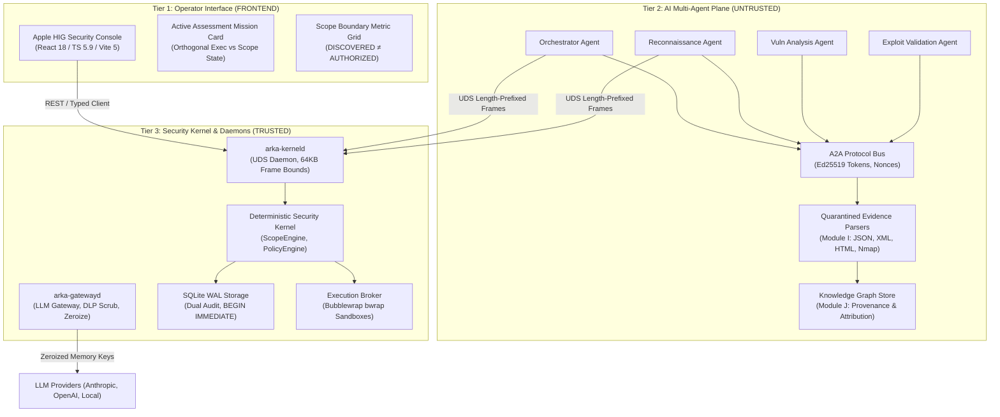

# ARKA Phase 3 Integrated Delivery & Architecture Report

**Document:** `docs/security/PHASE_3_INTEGRATED_DELIVERY_REPORT.md`  
**Governing Documents:** ARKA PRD v2.2, ARKA TRD v2.2, `AGENTS.md`, Phase 0 Foundation, Phase 1 Kernel, Phase 2 Broker  
**Date:** 2026-10-26  
**Status:** DELIVERED & AUDITED

---

## 1. Executive Summary

This report documents the architectural advancements, modules delivered, security validations, and graphified knowledge structure of the ARKA platform following the completion of Phase 0 (Security Foundation), Phase 1 (Deterministic Security Kernel), Phase 2 (Execution Broker & Sandboxes), and the implementation of Phase 3 modules.



---

## 2. Phase 3 Modules Delivered

### Module A: Frontend Security Operations Console (`frontend/`)
- **Visual Design Architecture:** Designed according to Apple Human Interface Guidelines (macOS Sequoia / iPadOS 18), featuring neutral canvases (`#F5F5F7` light / `#1C1C1E` dark), surface separation, Apple Blue accent (`#0071E3` / `#2997FF`), 18px squircles (`--radius-card`), and tabular numerals (`tnum`).
- **Active Assessment Mission Card (`ActiveMissionCard.tsx`):**
  - **Decoupled Execution & Scope States:** An assessment mission can be running (`ACTIVE`) while its scope policy is stale or invalid (`INVALID_SCOPE`). Displaying them as orthogonal badges eliminates operator deception.
  - **Invariant Enforcement ($\mathbf{DISCOVERED \neq AUTHORIZED}$):** Discovered attack surface assets are never aggregated or conflated with authorized targets. The card features an asymmetric 3-column metric layout distinguishing Authorized (In-Scope), Discovered (Inert), and Excluded targets.
  - **Transition Lockout:** Mutations disable interactive action triggers during in-flight state changes (`aria-busy="true"`).
  - **Fail-Closed Offline Safety:** The API client (`client.ts`) returns sample fixtures strictly for read-only `GET` queries. Sensitive mutations (`POST`, `PUT`, `DELETE`) fail closed (`code: UNAVAILABLE_DEPENDENCY`) when the backend Security Kernel is offline.
- **Automated Verification:** 25 unit and state-machine tests executed via Node's native test runner (`node --experimental-strip-types --test tests/*.test.ts`).

### Module I: Safe Evidence Analysis, Parsing & Provenance Pipeline (`arka/evidence`)
- **Quarantined Evidence Parsers (`parsers.py`):**
  - `SafeJsonParser`: Enforces payload byte limits (1MB) and maximum nesting depth (8).
  - `SafeXmlParser` & `NmapXmlParser`: Hardened XML parsing utilizing `defusedxml` to neutralize XXE, Billion Laughs, and quadratic entity expansion bombs.
  - `SafeHtmlParser`: Strips scripts, embedded objects, styles, and dangerous tags using a hardened HTML parser.
- **Content-Addressed Provenance:** Canonical SHA-256 evidence hashing binding raw observation data to execution envelopes.

### Module J: Knowledge Graph Provenance Validation (`arka/graph`)
- **Attack Surface Knowledge Graph (`store.py`, `models.py`):**
  - Manages structured graph state across nodes (`Host`, `Port`, `Service`, `Vulnerability`, `Credential`) and causal edges.
  - Enforces cryptographic agent attribution and mission-scoped isolation.
  - Comprehensive acceptance test suite (`tests/test_knowledge_graph.py`, `tests/test_phase3_integrated_acceptance.py`).

### Standalone Daemons Architecture (`crates/`)
- **`crates/arka-kerneld`:** Standalone Unix Domain Socket daemon providing isolated OS process boundaries for the Rust Security Kernel. Ingests length-prefixed frames, enforces strict JSON parsing (<=64KB, depth <=8, no duplicate keys), authenticates Ed25519 tokens, and dispatches to the Execution Broker.
- **`crates/arka-gatewayd`:** Standalone LLM Gateway UDS daemon providing credential isolation, automatic memory zeroization (`Zeroizing<String>`), outbound Data Loss Prevention (DLP) secret scrubbing, and local/mock/remote provider routing.

---

## 3. Supply Chain Hardening & CI Resolution

### Issue Diagnosis
The GitHub Actions workflow job `ci-sec-dependencies` in `.github/workflows/security-foundation.yml` failed with:
```text
ERR_PNPM_AUDIT_NO_LOCKFILE
No pnpm-lock.yaml found: Cannot audit a project without a lockfile
```

### Remediation Applied
1. **Pnpm Lockfile Generation:** Activated Corepack `pnpm@12.4.2` and imported the exact pinned dependency graph from `package-lock.json` into `frontend/pnpm-lock.yaml` (lockfile version 9.0).
2. **Corepack Manifest Integration:** Declared `"packageManager": "pnpm@12.4.2"` in `frontend/package.json`.
3. **Audit Execution:** Executed `pnpm audit --prod --audit-level=high` in `./frontend`, verifying zero known vulnerabilities (`No known vulnerabilities found`, exit code 0).
4. **Git Delivery:** Committed as `02d708b` and pushed to `feat/p2-execution-plane`.

---

## 4. Systemic STRIDE Security Audit & Remediation Verification

A comprehensive security audit conducted on the repository confirmed 6 vulnerabilities. All 6 findings have been remediated with negative test regression coverage and independently verified:

| Finding ID | Severity | Status | STRIDE Category | Vulnerability Type | Primary Location | Verification & Remediation Applied |
|---|:---:|:---:|---|---|---|---|
| **VULN-001** | 🔴 **HIGH** | ✅ **RESOLVED** | Tampering / EoP | OS Command Injection ([CWE-78](https://cwe.mitre.org/data/definitions/78.html)) | `workers/linux/wrappers/tcp_probe.sh` | Enforced RFC length limit (<= 253), character regex allowlist (`^[a-zA-Z0-9.:-]+$`), numeric port/timeout bounds, JSON escaping, and eliminated shell interpolation via positional args (`bash -c 'exec 3<>/dev/tcp/"$1"/"$2"' _ "$TARGET_HOST" "$TARGET_PORT"`). Injection tests verified. |
| **VULN-002** | 🔴 **HIGH** | ✅ **RESOLVED** | EoP / Info Disclosure | Default Permissive Fallback Scope ([CWE-1188](https://cwe.mitre.org/data/definitions/1188.html)) | `crates/arka-kerneld/src/server.rs` | Removed permissive fallback scope (`127.0.0.1`, `192.168.1.1`). Requests referencing unregistered scopes fail closed immediately with `KernelResponse::deny(..., "ERR_SCOPE_NOT_FOUND", ...)`. Verified via `test_ipc_unregistered_scope_reference_denied_fail_closed`. |
| **VULN-003** | 🟡 **MEDIUM** | ✅ **RESOLVED** | Spoofing / EoP | Incomplete Peer Auth Gate ([CWE-306](https://cwe.mitre.org/data/definitions/306.html)) | `crates/arka-gatewayd/src/server.rs`, `arka-kerneld/src/server.rs` | Enforced `0o660` socket filesystem permissions on creation. Gateway and Kernel peer auth check now fail-closed: if `enforce_peer_auth` is enabled and `allowed_uid` is `None` or mismatched, connection is denied with `PeerAuthFailed`. Environment variables added for daemon deployment. |
| **VULN-004** | 🟡 **MEDIUM** | ✅ **RESOLVED** | Info Disclosure | Single-Match DLP Redaction Leak ([CWE-200](https://cwe.mitre.org/data/definitions/200.html)) | `crates/arka-gatewayd/src/dlp.rs` | Replaced single `find` with `while let` iterative loops with cursor advancement for Anthropic (`sk-ant-`), OpenAI (`sk-`), Private Keys (`BEGIN PRIVATE KEY`), internal tokens (`tok_`), and AWS keys (`AKIA...`). Unit tests added verifying multiple keys in single strings and passing. |
| **VULN-005** | 🟡 **MEDIUM** | ✅ **RESOLVED** | Repudiation | In-Memory Storage & Ephemeral Keys ([CWE-311](https://cwe.mitre.org/data/definitions/311.html)) | `crates/arka-kerneld/src/main.rs` | Integrated `ARKA_DATABASE_PATH` configuration with persistent `SqliteStorage::new(db_path)`. Guarded ephemeral in-memory storage behind explicit `ARKA_ALLOW_IN_MEMORY_STORAGE=1` with operator audit warning. |
| **VULN-006** | 🔵 **LOW** | ✅ **RESOLVED** | DoS / Tampering | JSON Recursion & Duplicate Key Differential ([CWE-674](https://cwe.mitre.org/data/definitions/674.html)) | `arka/evidence/parsers.py` | Implemented `object_pairs_hook=reject_duplicates` to reject duplicate JSON keys with `EvidenceParserError`. Added stack-based iterative depth validation and caught `RecursionError` converting to `ParserBombError`. Verified via unit tests in `tests/test_evidence_pipeline.py`. |

---

## 5. Architecture Knowledge Graph (Graphify State)

The codebase was re-indexed with `graphify update .`, producing an updated AST knowledge graph, community clustering, and interactive visual reports:

- **Built From Commit:** `02d708bf`
- **Total Nodes:** 4,024
- **Total Edges:** 7,687
- **Communities:** 210 communities (191 significant, 19 thin)
- **Extraction Confidence:** 96% EXTRACTED, 4% INFERRED (average confidence: 0.91)
- **Corpus Volume:** 287 files (~190,608 words)
- **Key Navigation Community Hubs:**
  - `ARKA_TRD_v2.2.md` & `ARKA_PRD_v2.2.md`
  - `DevKeyProvider` & `DevelopmentKeyProvider` (6-domain cryptographic isolation)
  - `StrictJsonParser` (`json_strict.rs`, depth <= 8, max 64KB, duplicate rejection)
  - `ScopeEngine` & `CidrBlock` (default-deny, exclusions > inclusions)
  - `ActiveMissionCard` & `MissionState` (orthogonal state derivation)
  - `KnowledgeGraphStore` (attack surface node/edge provenance)
  - `RedirectHandler` (hop-by-hop HTTP redirect inspection & pinning)
  - `bwrap` container supervision (`SandboxSupervisor`)

---

## 6. Verification Evidence Summary

| Component / Layer | Command | Status | Details |
|---|---|:---:|---|
| **Rust Kernel Workspace** | `cargo test --all` | ✅ **PASS** | All unit, integration, and adversarial tests passing (including IPC fail-closed scope tests and DLP multi-secret scrubbing). |
| **Rust Compiler Lints** | `cargo clippy --all-targets --all-features -- -D warnings` | ✅ **PASS** | Zero compiler warnings; `#![forbid(unsafe_code)]` enforced. |
| **Rust Formatting** | `cargo fmt --check` | ✅ **PASS** | 100% compliant with standard Rust formatting. |
| **Python Evidence Pipeline** | `python3 -m unittest tests/test_evidence_pipeline.py` | ✅ **PASS** | 17 tests passing (including duplicate key rejection & recursion bomb defenses). |
| **Frontend Unit Tests** | `npm --prefix frontend test` | ✅ **PASS** | 25 automated invariant & state-machine tests passing. |
| **Frontend Type Safety** | `npm --prefix frontend exec tsc -- -p frontend/tsconfig.json --noEmit` | ✅ **PASS** | Zero TypeScript compilation errors. |
| **Frontend Production Build** | `npm --prefix frontend run build` | ✅ **PASS** | Vite production bundle compiled in 2.57s. |
| **Frontend Supply Chain** | `cd frontend && pnpm audit --prod --audit-level=high` | ✅ **PASS** | Zero known vulnerabilities found. |
| **Security Foundation Model** | `python3 security/validator/validate_security_model.py` | ✅ **PASS** | 100% control traceability across 35 threats. |
| **Knowledge Graph** | `graphify update .` | ✅ **PASS** | Graph synchronized at commit `02d708bf` (4,024 nodes). |
