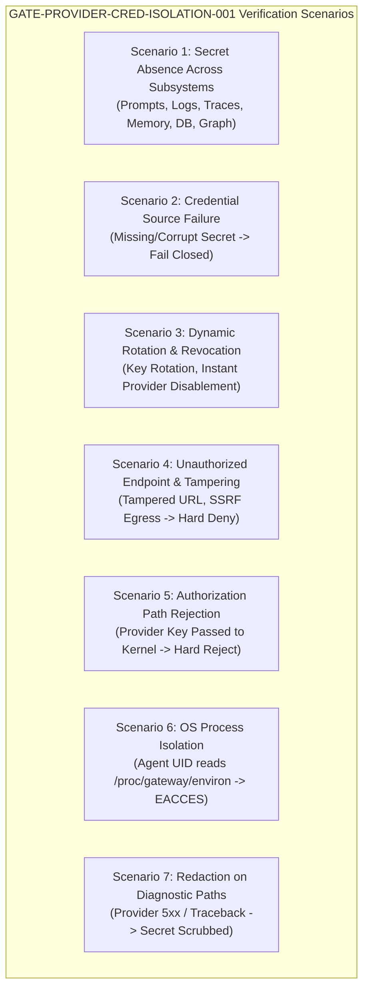

# ARKA Phase 3 — Module A Security Acceptance Matrix & Dedicated Credential Gate Proposal

**Document:** `docs/security/PHASE_3_MODULE_A_ACCEPTANCE_MATRIX.md`  
**Classification:** Internal Security Architecture & Quality Gate Specification  
**Date:** 2026-10-25  
**Authors:** Senior Rust Security Architect, Python AI Systems Engineer, Application Security Reviewer  
**Governing Documents:** ARKA PRD v2.2, ARKA TRD v2.2, `mvp security acceptance gates.md`, `security/acceptance/gates.yaml`, `.github/CODEOWNERS`  
**Target Milestone:** Phase 3 Module A — Architecture, Contracts, and Governance Baseline  
**Gate Status:** PROPOSED (Pending formal CODEOWNER sign-off by `@jivi001`)

---

## 1. Executive Summary

This document specifies the authoritative security acceptance criteria for ARKA Phase 3. 

The baseline audit identified that while eight Phase 3 acceptance gates are currently registered in `security/acceptance/gates.yaml`, existing controls focus on prompt inspection and token DLP, but **do not establish a dedicated, enforceable acceptance gate for LLM provider credential isolation, OS-level process boundaries, rotation/revocation, or fail-closed provider disablement**.

To close this critical governance gap, this document drafts the dedicated acceptance gate:
$$\mathbf{GATE-PROVIDER-CRED-ISOLATION-001}$$
and provides the exact, schema-compliant YAML additions for submission to human CODEOWNER (`@jivi001`).

**Non-Negotiable Rule:** In accordance with `.github/CODEOWNERS`, automated systems cannot alter security baselines. These specifications are formal proposals for CODEOWNER review and are labeled `PROPOSED` or `NOT RUN`. Never label a gate `PASS` during design-only work.

---

## 2. Dedicated Gate Proposal: `GATE-PROVIDER-CRED-ISOLATION-001`

### 2.1 Gate Specification

| Gate Attribute | Definition |
|---|---|
| **Gate Identifier** | `GATE-PROVIDER-CRED-ISOLATION-001` |
| **Gate Name** | Dedicated LLM Provider Credential Isolation and Egress Defense Gate |
| **Phase** | `Phase 3` (Intelligence & Multi-Agent Plane) |
| **Classification** | High-Severity Blocking Security Acceptance Gate |
| **Security Invariant** | `INV-011`: Provider credentials resolved exclusively by LLM Gateway; never enter agent context, memory, logs, evidence, or proposals.<br>`INV-012`: Provider credentials grant inference access only, never ARKA execution authority. |
| **Enforcement Layer** | Linux OS DAC, `arka-gatewayd` Process Namespace, Memory Zeroization, ScopeGuard Connector |
| **Owner** | Intelligence Plane Lead & Security Architecture Owner (`@jivi001`) |
| **Lifecycle Status** | `PROPOSED (BLOCKING)` |

---

### 2.2 The Seven Mandatory Executable Test Scenarios

The gate requires executable, deterministic test proofs across seven distinct attack and operational scenarios:



#### Scenario 1: Comprehensive Secret Absence
- **Objective:** Prove that raw provider secrets (API keys, bearer tokens) are never stored or emitted in any observable artifact.
- **Test Implementation:** Execute 100 automated inference cycles. Scan the following targets using cryptographic search and high-entropy pattern matchers:
  1. LLM Prompt templates and formatted request context.
  2. Gateway and agent structured logs, console output, and debug traces.
  3. Python and Rust exception tracebacks and error responses.
  4. Ingested Evidence artifacts and SQLite evidence storage.
  5. Audit log payloads (`system_audit_log`, `mission_audit_log`).
  6. Agent heap memory dumps (via memory sampling).
  7. Knowledge Graph nodes, edges, and relationship attributes.
  8. `RawActionProposal` and `CanonicalAction` parameter structures.
- **Expected Result:** Zero byte-for-byte matches of the provider secret string in any artifact (`PASS`).

#### Scenario 2: Credential Source Failure & Fail-Closed Behavior
- **Objective:** Verify system behavior when the configured secret source is unreachable, unreadable, or missing.
- **Test Implementation:** Simulate credential source outage (unset environment variable, lock OS keyring, mock KMS outage). Submit an inference request from an agent.
- **Expected Result:** Gateway returns sanitized error `ERR_CREDENTIAL_UNAVAILABLE`. Zero fallback to insecure local execution, mock responses, or cleartext caches. Service fails closed (`PASS`).

#### Scenario 3: Credential Rotation, Revocation, and Provider Disablement
- **Objective:** Verify dynamic secret rotation without service interruption, and immediate cessation of outbound traffic upon provider disablement.
- **Test Implementation:**
  1. Trigger dynamic secret rotation: verify that new inference calls immediately adopt Key $K_2$ and securely zeroize Key $K_1$ in memory (`zeroize`).
  2. Trigger provider emergency revocation: disable provider in configuration. Verify that all in-flight requests are aborted and subsequent calls fail closed instantly.
- **Expected Result:** Key zeroization verified; zero outbound packets dispatched to revoked provider (`PASS`).

#### Scenario 4: Unauthorized Endpoint & Configuration-Tampering Defense
- **Objective:** Prevent Server-Side Request Forgery (SSRF) and endpoint manipulation.
- **Test Implementation:**
  1. Agent attempts to override provider base URL with internal addresses (`127.0.0.1`, `169.254.169.254`, `10.0.0.1`).
  2. Agent injects HTTP header manipulation payloads into model parameters.
- **Expected Result:** ScopeGuard connector detects non-allowlisted endpoint and aborts connection before TCP handshake; logs `SSRF_ATTEMPT_BLOCKED` (`PASS`).

#### Scenario 5: Provider Credentials Rejected by ARKA Authorization Paths
- **Objective:** Prove that a provider credential cannot be used as an ARKA authorization token.
- **Test Implementation:** Submit an `ActionProposalRequest` to `arka-kerneld` passing a valid OpenAI/Anthropic API key in the `auth_token` field.
- **Expected Result:** Kernel token verifier fails immediately (`UNAUTHORIZED_TOKEN`); kernel rejects proposal and logs security event (`PASS`).

#### Scenario 6: OS-Level Process & Privilege Isolation
- **Objective:** Prove that an untrusted agent process cannot access Gateway process memory or files.
- **Test Implementation:** Spawn agent process under UID `arka-agent` and Gateway under UID `arka-gateway`. Execute agent script attempting:
  1. `open("/proc/<gateway_pid>/environ", O_RDONLY)` -> Assert `EACCES` (Permission Denied).
  2. `ptrace(PTRACE_ATTACH, <gateway_pid>)` -> Assert `EPERM` (Operation Not Permitted).
  3. `open("/run/arka/gateway_secrets.json", O_RDONLY)` -> Assert `EACCES`.
- **Expected Result:** Linux kernel Discretionary Access Control (DAC) strictly enforces process isolation (`PASS`).

#### Scenario 7: Redaction on Diagnostic and Provider Failure Paths
- **Objective:** Ensure secrets are not leaked when upstream providers fail or return error diagnostics.
- **Test Implementation:** Configure mock provider endpoint returning an HTTP 500 error containing the sent `Authorization: Bearer sk-ant-secret123` in the error response body.
- **Expected Result:** Gateway error scrubber scrubs all authorization headers and secret tokens, replacing them with `[REDACTED]`, before propagating the error to agent callers or logs (`PASS`).

---

## 3. Schema-Compliant YAML Updates for Submission to `@jivi001`

The following registry entries are prepared for formal review and integration by `@jivi001`:

### 3.1 Addition to `security/threat-model/threats.yaml`
```yaml
- id: THREAT-PROVIDER-CRED-THEFT
  name: LLM Provider API Credential Compromise and Exfiltration
  stride: Information Disclosure
  description: Adversary coerces agent via prompt injection or process memory inspection into exfiltrating external LLM provider API credentials.
  threat_actors:
  - ACTOR-MALICIOUS-AGENT
  - ACTOR-EXTERNAL-TARGET
  attack_surfaces:
  - SURF-LLM-GATEWAY
  - SURF-AGENT-RUNTIME
  assets_impacted:
  - ASSET-LLM-CREDENTIALS
  risk_level: Critical
  likelihood: High
  impact: Catastrophic
  owner: Intelligence Plane Lead
  phase: 3
  gate_ids:
  - GATE-PROVIDER-CRED-ISOLATION-001
  control_ids:
  - CTRL-PROVIDER-CRED-ISOLATION-001
```

### 3.2 Addition to `security/controls/controls.yaml`
```yaml
- id: CTRL-PROVIDER-CRED-ISOLATION-001
  name: Dedicated LLM Provider Credential Isolation and Memory Zeroization
  phase: 3
  threats:
  - THREAT-PROVIDER-CRED-THEFT
  components:
  - COMP-LLM-GW
  security_property: Raw provider credentials exist exclusively in Gateway memory, are zeroized after use, and are physically inaccessible to agent processes.
  enforcement_layer:
  - os-process-dac
  - memory-zeroize
  - scopeguard-connector
  test_ids:
  - TEST-PROVIDER-CRED-ISOLATION-001
  gate_ids:
  - GATE-PROVIDER-CRED-ISOLATION-001
  audit_events:
  - CREDENTIAL_LOADED
  - CREDENTIAL_ROTATED
  - CREDENTIAL_REVOKED
```

### 3.3 Addition to `security/acceptance/gates.yaml`
```yaml
- id: GATE-PROVIDER-CRED-ISOLATION-001
  name: Dedicated LLM Provider Credential Isolation Gate
  phase: 3
  threats:
  - THREAT-PROVIDER-CRED-THEFT
  controls:
  - CTRL-PROVIDER-CRED-ISOLATION-001
  tests:
  - TEST-PROVIDER-CRED-ISOLATION-001
  owner: Security Architecture Lead
  blocking: true
  verification_method: Automated Adversarial and OS Namespace Test Suite
  pass_criteria: All 7 provider credential isolation scenarios pass with zero secret leakage.
```

### 3.4 Addition to `security/tests/tests.yaml`
```yaml
- id: TEST-PROVIDER-CRED-ISOLATION-001
  name: LLM Provider Credential Process Isolation and Egress Defense Test
  threats:
  - THREAT-PROVIDER-CRED-THEFT
  controls:
  - CTRL-PROVIDER-CRED-ISOLATION-001
  owner: Intelligence Plane Lead
  phase: 3
  status: PENDING(phase=3)
  expected_property: Provider secrets are completely inaccessible to agent processes, absent from all traces, and protected by fail-closed isolation.
  test_path: tests/security/test_provider_cred_isolation.py
```

### 3.5 Addition to `security/traceability/security-traceability.yaml`
```yaml
- trace_id: TRACE-PROVIDER-CRED-001
  phase: 3
  threat_id: THREAT-PROVIDER-CRED-THEFT
  control_id: CTRL-PROVIDER-CRED-ISOLATION-001
  gate_id: GATE-PROVIDER-CRED-ISOLATION-001
  test_id: TEST-PROVIDER-CRED-ISOLATION-001
  target_component: COMP-LLM-GW
  implementation_status: SPECIFIED
  evidence_path: docs/security/PHASE_3_MODULE_A_ACCEPTANCE_MATRIX.md
```

---

## 4. Phase 3 Complete Gate Mapping & Gap Analysis

| Existing Gate ID | Registered Property | Phase 3 Module Coverage | Identified Coverage Gap |
|---|---|:---:|---|
| `GATE-CONTENT-ISOLATION-001` | Malicious Target Content Quarantine Gate | Module F, I | Lacks formal classification rules for evidence sensitivity before storage. |
| `GATE-PROMPT-GUARD-001` | Prompt Injection Kernel Ingestion Defense Gate | Module F, G | Tested only conceptually; requires shared adversarial injection benchmark. |
| `GATE-TOOL-OUTPUT-001` | Tool Output Poisoning and Escape Code Gate | Module F | Covers ANSI scrubbing, but lacks delimiter escaping for nested JSON structures. |
| `GATE-A2A-AUTH-001` | Agent-to-Agent Message Verification Gate | Module H | Pending DEC-04 key domain ratification and DEC-05 clock skew agreement. |
| `GATE-EGRESS-FILTER-001` | LLM Gateway Data Loss Prevention Gate | Module B, D | Regex DLP alone is vulnerable to encoding evasion (Base64, hex); needs schema pinning. |
| `GATE-PARSER-SANDBOX-001` | Evidence Parser Sandbox Containment Gate | Module I | Parsers currently run on host; requires rootless Bubblewrap worker profiles. |
| `GATE-GRAPH-INTEGRITY-001` | Knowledge Graph Provenance Validation Gate | Module J | Graphify integration lacks cryptographic edge verification against SQLite audit receipts. |
| `GATE-LLM-EGRESS-001` | Prompt Context Token and Key DLP Gate | Module B, F | Focuses on outbound context, not OS-level credential isolation. |
| **`GATE-PROVIDER-CRED-ISOLATION-001`** | **Dedicated LLM Provider Credential Isolation Gate** | **Module B, C, D** | **New Proposed Gate: Fills the OS process boundary and secret lifecycle void.** |

---

## 5. Review & Approval Protocol

1. **Submission:** This matrix is delivered as part of Module A.
2. **Review:** `@jivi001` reviews proposed entries against PRD v2.2 §17 and TRD v2.2 §28.
3. **Ratification:** Upon CODEOWNER approval, the YAML definitions will be applied to the `/security/` registries and committed alongside an updated `security/baseline.manifest`.
4. **Enforcement:** No Phase 3 module may exit to production until `GATE-PROVIDER-CRED-ISOLATION-001` has executed with all seven test scenarios verified `PASS`.
