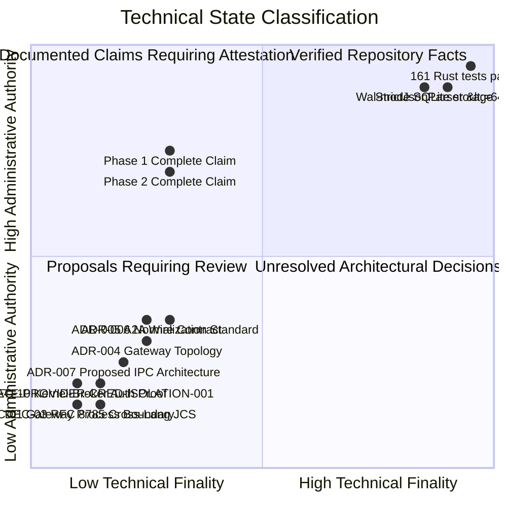

# ARKA Phase 3 — Module A Baseline Security & Governance Re-Audit

**Document:** `docs/security/PHASE_3_MODULE_A_BASELINE_AUDIT.md`  
**Classification:** Internal Security Architecture & Governance Audit  
**Date:** 2026-10-25  
**Auditor:** Senior Rust Security Architect, Python AI Systems Engineer, Application Security Reviewer  
**Governing Documents:** ARKA PRD v2.2, ARKA TRD v2.2, `AGENTS.md`, `mvp security acceptance gates.md`, `.github/CODEOWNERS`  
**Target Milestone:** Phase 3 Module A — Architecture, Contracts, and Governance Baseline  
**Current Module Status:** `BLOCKED` (Awaiting human CODEOWNER architectural ratifications)

---

## 1. Executive Summary

This audit establishes the authoritative, verified technical and governance baseline for **ARKA Phase 3: Intelligence & Multi-Agent Plane** before any runtime implementation work begins.

Following the core architectural axiom:
$$\mathbf{DISCOVERED \neq AUTHORIZED}$$
and the defining execution pipeline:
$$\mathbf{\text{LLM Proposes}} \longrightarrow \mathbf{\text{Rust Kernel Authorizes}} \longrightarrow \mathbf{\text{Execution Broker Executes}} \longrightarrow \mathbf{\text{Isolated Worker Operates}} \longrightarrow \mathbf{\text{Evidence Records}}$$

Phase 3 introduces the Python-based Intelligence Plane (LLM Gateway, autonomous agents, inter-agent messaging, untrusted evidence processing, and knowledge graph). This baseline audit re-examines the repository state, verifies existing Phase 0–2 implementation and governance gates, evaluates reported findings from prior audits, analyzes the absent Python-to-Rust communication boundary, and identifies all blocking human decisions.

**Core Audit Conclusion:**  
Phase 3 Module A is **BLOCKED**. While Phase 0, 1, and 2 codebases are structurally complete with passing test suites, Phase 3 runtime implementation cannot begin because:
1. No Rust kernel service binary or external IPC interface exists in the workspace.
2. The Python-to-Rust transport and authentication architecture is unapproved (`ADR-007` is `PROPOSED`).
3. Core Phase 3 architecture decisions (`DEC-01` through `DEC-14` in `PHASE_3.1C_DECISION_REGISTER.md`) remain open and require human CODEOWNER (`@jivi001`) ratification.
4. Phase 1 and 2 formal release attestations remain pending (`COMPLETE_WITH_WARNINGS`), and production broker execution is disabled.
5. A dedicated acceptance gate for provider credential isolation (`GATE-PROVIDER-CRED-ISOLATION-001`) is missing from the baseline acceptance registry.

---

## 2. Repository & Toolchain Verification

| Attribute | Verified Repository Fact | Security Consequence |
|---|---|---|
| **Git Branch** | `feat/p2-execution-plane` (upstream `origin/feat/p2-execution-plane`) | Verified current branch; clean working tree, 0 ahead/behind. |
| **Commit ID** | `5f38292ebc646fe5cd5a615ae242cb107d205743` | HEAD incorporates Phase 3.1c documentation, ADRs, test vectors, and decision register. |
| **Rust Toolchain** | `cargo 1.99.0` / `rustc 1.99.0 (b940084d7 2026-09-28)` | Stable 2021 edition toolchain; `#![forbid(unsafe_code)]` enforced across all crates. |
| **Python Toolchain**| `Python 3.13.5` | Target Python runtime for agent plane and security model validator. |
| **Code Hygiene** | `cargo fmt --check` -> PASS (0 violations) `cargo clippy --all-targets --all-features -- -D warnings` -> PASS (0 warnings) | Baseline code conforms to strict linting and formatting rules. |
| **Rust Test Suite** | `cargo test --workspace` -> **161/161 tests PASS** (0 failures, 0 ignored) | Covers Phase 1 kernel (92 tests) and Phase 2 broker/network/sandbox (69 tests). |
| **Python Tests** | `python3 -m unittest discover -s tests/security -v` -> **22/22 tests PASS** | Validates baseline manifest, key provider, domain separation, and meta-validator rules. |
| **Model Validator**| `python3 security/validator/validate_security_model.py` -> **PASS** | 35 threats, 39 controls, 37 gates, 44 tests, 6 key domains; 100% registered threat coverage. |

---

## 3. Re-Audit of Reported Baseline Findings

The prior audit report dated 2026-10-25 recorded five specific findings. Each has been re-verified against the physical repository:

### 3.1 Finding 1: Absence of Python Intelligence Application
- **Reported Claim:** The repository contains no Python intelligence application.
- **Physical Verification:** **CONFIRMED FACT.**  
  Directory `./arka` contains exclusively:
  - `arka/core/crypto/__init__.py`
  - `arka/core/crypto/provider.py` (Local development mock key provider for `KeyDomain`)
  There is zero Python implementation for:
  - LLM Gateway (`arka.gateway`)
  - Agent runtime or agent roles (`arka.agents`)
  - Agent-to-Agent protocol (`arka.a2a`)
  - Action normalization bridge (`arka.bridge`)
  - Evidence parsing or quarantine (`arka.evidence`)
  - Knowledge graph (`arka.graph`)

### 3.2 Finding 2: Absence of Rust Kernel Service Binary or IPC Surface
- **Reported Claim:** No kernel service binary or external IPC interface exists.
- **Physical Verification:** **CONFIRMED FACT.**  
  `crates/arka-kernel` is configured strictly as a Rust library crate (`[lib]`). The workspace contains no binary target (`src/bin/`, `[[bin]]`) for a kernel service daemon (`arka-kerneld`).
  The kernel APIs (`ActionNormalizer`, `AuthorizationEngine`, `MissionService`, `ScopeEngine`) are in-process Rust structs callable only by other Rust crates compiled into the same memory space. There is no Unix domain socket listener, named pipe, gRPC server, HTTP endpoint, or FFI binding (`pyo3` / `c-ffi`) currently implemented.

### 3.3 Finding 3: Status of D-001–D-007 Decision Register
- **Reported Claim:** Decision register D-001–D-007 was absent.
- **Physical Verification:** **CLARIFIED FACT.**  
  No file named `D-001–D-007` exists. However, commit `5f38292` introduced `docs/security/PHASE_3.1C_DECISION_REGISTER.md`, which defines **DEC-01 through DEC-14**, capturing the exact unresolved architectural risks blocking Phase 3. Specifically:
  - `DEC-01`: Gateway topology and OS identity (Critical)
  - `DEC-02`: TLS implementation gap (Critical)
  - `DEC-03`: RFC 8785 JCS ratification and hash compatibility (Critical)
  - `DEC-04`: A2A key domain and signing authority (High)
  - `DEC-05`: A2A expiry and clock skew (High)
  - `DEC-06`: Replay state durability and crash recovery (High)
  - `DEC-07`: Provider destination and local-model policy (High)
  - `DEC-08`: External data classifications (High)
  - `DEC-09`: Phase 2 traceability status mismatch (Medium)
  - `DEC-10`: Kernel-to-Broker authorization proof (High)
  - `DEC-11`: Capability parameter schemas (High)
  - `DEC-12`: Phase 3.1b provenance (Medium)
  - `DEC-13`: Test/gate coverage beyond OWASP categories (Medium)
  - `DEC-14`: Production execution and egress enablement (Release Blocker)

### 3.4 Finding 4: Phase 1 and Phase 2 Acceptance Status & Attestations
- **Reported Claim:** Phase 1 and 2 are `COMPLETE_WITH_WARNINGS` with pending CODEOWNER attestations.
- **Physical Verification:** **CONFIRMED FACT.**  
  Inspection of `security/acceptance/phase-status.yaml` verifies:
  - **Phase 0:** `COMPLETE_WITH_WARNINGS`  
    *Warning:* `BLOCKED_EXTERNAL_CONFIGURATION`: GitHub Branch Protection rules require manual activation by `@jivi001` in repository settings (`docs/security/BRANCH_PROTECTION.md`).
  - **Phase 1:** `COMPLETE_WITH_WARNINGS`  
    *Warning:* `PENDING_FORMAL_CODEOWNER_ATTESTATION`: Implementation verified by independent re-audit report (PASS) and 92/92 passing integration tests. Formal release registry sign-off by human CODEOWNER (`@jivi001`) required.
  - **Phase 2:** `COMPLETE_WITH_WARNINGS`  
    *Warning 1:* `PENDING_FORMAL_CODEOWNER_ATTESTATION`: Implementation verified by comprehensive test suite (161/161 passing tests). Formal sign-off by `@jivi001` required.  
    *Warning 2:* `PRODUCTION_EXECUTION_DISABLED`: Execution Broker remains in non-production / dry-run mode until formal human CODEOWNER release sign-off.
  - **Phase 3:** `NOT_STARTED` (0 evidence links, 0 warnings).

### 3.5 Finding 5: Dedicated Provider-Credential-Isolation Acceptance Gate
- **Reported Claim:** Missing dedicated Phase 3 provider-credential-isolation acceptance gate.
- **Physical Verification:** **CONFIRMED FACT.**  
  In `security/acceptance/gates.yaml`, 8 Phase 3 gates exist:
  1. `GATE-CONTENT-ISOLATION-001` (Quarantine target content)
  2. `GATE-PROMPT-GUARD-001` (Prompt injection kernel defense)
  3. `GATE-TOOL-OUTPUT-001` (Tool output sanitization)
  4. `GATE-A2A-AUTH-001` (Agent message verification)
  5. `GATE-EGRESS-FILTER-001` (LLM gateway data loss prevention)
  6. `GATE-PARSER-SANDBOX-001` (Evidence parser sandbox)
  7. `GATE-GRAPH-INTEGRITY-001` (Knowledge graph provenance)
  8. `GATE-LLM-EGRESS-001` (Prompt context token and key DLP)
  
  Existing gates (`GATE-EGRESS-FILTER-001` and `GATE-LLM-EGRESS-001`) inspect prompt payloads via regex/token scanning to prevent exfiltration, but **do not enforce**:
  - Process-level isolation preventing agents from accessing raw provider credentials.
  - Gateway-exclusive resolution from OS secure vaults / KMS.
  - Credential rotation, revocation, and fail-closed disablement.
  - Endpoint binding preventing provider credentials from being routed to untrusted destinations.
  A dedicated gate—`GATE-PROVIDER-CRED-ISOLATION-001`—is required.

---

## 4. Current CODEOWNER Requirements & Security Governance

Inspection of `.github/CODEOWNERS` establishes non-negotiable governance rules:
- **Platform Owner & Sole Security Approver:** `@jivi001`.
- **Protected Paths:**
  - `/security/` (including all subdirectories: `threat-model/`, `controls/`, `acceptance/`, `traceability/`, `keys/`, `tests/`, `validator/`, `baseline.manifest`).
  - `/tests/security/`
  - `/arka/core/crypto/`
  - `/.github/` (including workflows and `CODEOWNERS`).
  - `/PRD(1).md`, `/ARKA_TRD_v2.1.md`, `/mvp security acceptance gates.md`.

### Governance Rule Enforced:
Automated agents, LLM pipelines, and pair-programming assistants have **ZERO authority** to modify security baselines, promote phase status, dismiss warnings, or alter acceptance gates. All changes to protected files must be prepared as proposals and submitted for formal CODEOWNER review.

---

## 5. Architectural Status of Crates & Interfaces

| Crate | Current State | Phase 3 Interface Readiness |
|---|---|---|
| `arka-core-types` | Implemented, 8 unit tests pass | **Production Ready.** Defines `CanonicalAction`, `RawActionProposal`, `AuthenticatedContext`, `Subject`, `RiskClass`, `MissionId`, `ProposalId`. Strict Serde with `deny_unknown_fields`. |
| `arka-crypto` | Implemented, 15 tests pass | **Production Ready.** Strict JSON parser (`StrictJsonParser`: <=64KB, depth <=8, no duplicate keys), JCS canonicalization, Ed25519 signing, SHA-256 with domain separation. Cross-language Python parity test suite needed for JCS. |
| `arka-storage-sqlite`| Implemented, WAL mode enabled | **Production Ready.** SQLite storage engine implementing `Storage` trait for mission state, replay log, audit log, approvals. |
| `arka-kernel` | Implemented, 92 tests pass | **Library Ready; IPC Surface Absent.** `ActionNormalizer` and `AuthorizationEngine` are fully verified. However, no IPC server binary exists to expose them to Python. |
| `arka-execution-broker`| Implemented, 43 tests pass | **Dry-Run Only.** Pre-dispatch verification, resource governor, evidence collector. Production target execution is disabled until Phase 2 formal sign-off. Crucially, DEC-10 notes the broker preflight checks non-empty hashes but lacks unforgeable kernel authorization receipts. |
| `arka-network-policy`| Implemented, 26 tests pass | **Production Ready.** ScopeGuard direct-IP connector, DNS pinning, redirect re-validation, loopback/RFC1918 blocking. |
| `arka-worker-protocol`| Implemented, 6 tests pass | **Production Ready.** Wire protocol for sandbox workers. |

---

## 6. Distinguishing Facts, Claims, Proposals, and Open Decisions

To ensure absolute transparency, repository elements are classified into four distinct categories:

1. **Verified Repository Facts:**
   - 161 Rust integration tests and 22 Python security tests pass cleanly on current HEAD.
   - Codebase strictly forbids unsafe Rust (`#![forbid(unsafe_code)]`).
   - Normalization boundary `StrictJsonParser` rejects >64KB, depth >8, and duplicate keys.
   - Rust kernel enforces atomic check-and-consume replay logging and dual-chain audit logging (`AUDIT-SIGNING`).
   - No Python agent runtime, LLM Gateway, or IPC server binary exists in the repository.

2. **Documented Claims Requiring Attestation:**
   - Phase 0 marked `COMPLETE_WITH_WARNINGS` pending manual branch protection activation.
   - Phase 1 marked `COMPLETE_WITH_WARNINGS` pending `@jivi001` formal release registry sign-off.
   - Phase 2 marked `COMPLETE_WITH_WARNINGS` pending `@jivi001` sign-off; execution broker dry-run mode active.

3. **Proposals Requiring Review:**
   - `ADR-004`: LLM Gateway topology, credential isolation, and pinned egress (`PROPOSED`).
   - `ADR-005`: Agent-to-Agent identity, authentication, and cryptographic message contract (`PROPOSED`).
   - `ADR-006`: Single action normalization boundary and RFC 8785 canonicalization (`PROPOSED`).
   - `ADR-007`: Python-to-Rust local IPC transport, service boundary, and authentication (`PROPOSED` in Module A).
   - `GATE-PROVIDER-CRED-ISOLATION-001`: Dedicated provider credential isolation gate proposal.

4. **Unresolved Architectural Decisions:**
   - Decisions `DEC-01` through `DEC-14` in `PHASE_3.1C_DECISION_REGISTER.md` must be ratified by `@jivi001` before Phase 3 runtime implementation.

---

## 7. Baseline Audit Sign-Off & Module A Exit Decision

- **Baseline Audit Status:** `AUDIT COMPLETE — PROCEEDING WITH MODULE A DELIVERABLES`
- **Phase 3 Implementation Gate:** `BLOCKED`
- **Permitted Work:** Delivery of Module A architecture specifications, ADR-007, contracts, threat models, and gate proposals. Zero runtime implementation of Modules B–J is permitted.
- **Next Step:** Complete Module A deliverables (ADR-007, Architecture Decisions, Contracts, Threat Model, Acceptance Matrix, Readiness Report) and submit package to `@jivi001`.
