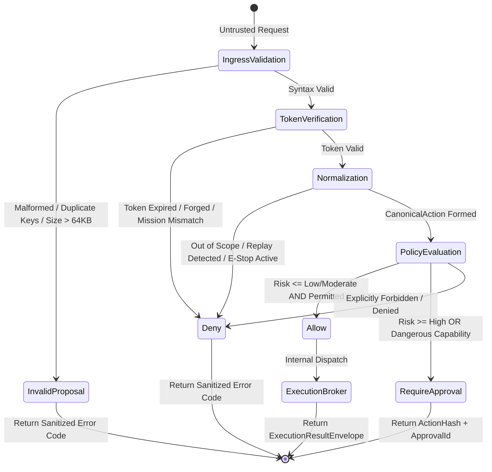
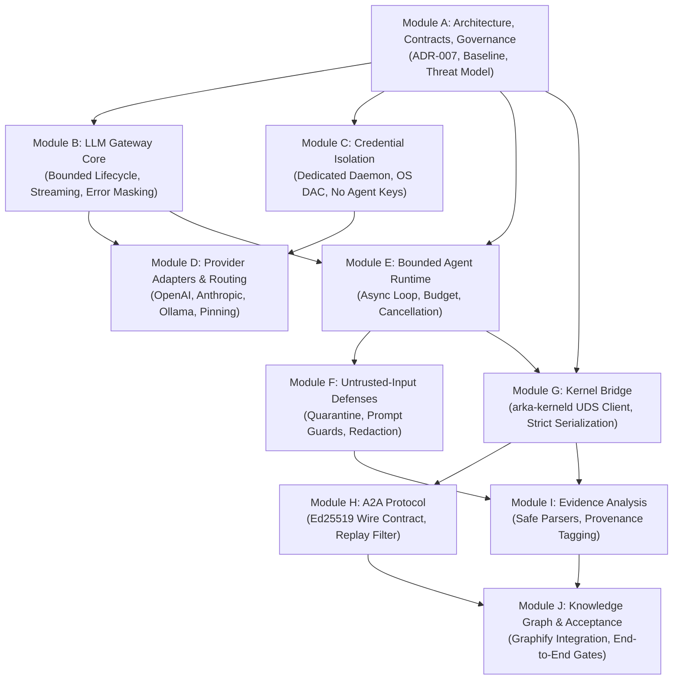

# ARKA Phase 3 — Module A Interface & Data Contract Specification

**Document:** `docs/security/PHASE_3_MODULE_A_CONTRACTS.md`  
**Classification:** Internal Security Architecture & Protocol Specification  
**Date:** 2026-10-25  
**Authors:** Senior Rust Security Architect, Python AI Systems Engineer, Application Security Reviewer  
**Governing Documents:** ARKA PRD v2.2, ARKA TRD v2.2, `AGENTS.md`, `ADR-004`, `ADR-005`, `ADR-006`, `ADR-007`  
**Target Milestone:** Phase 3 Module A — Architecture, Contracts, and Governance Baseline  
**Status:** PROPOSED (Pending human CODEOWNER ratification by `@jivi001`)

---

## 1. Foundational Contract Principles

The contracts specified herein govern all inter-module and cross-language communication in ARKA Phase 3. They enforce the core architectural axioms:

$$\mathbf{INV-001:}\quad \text{The LLM plane has zero direct operating system, shell, socket, or network execution authority.}$$
$$\mathbf{INV-004:}\quad \text{An action's authority and identity come strictly from an AuthenticatedContext, never untrusted input.}$$
$$\mathbf{INV-005:}\quad \text{Approval MUST bind to a canonical hash of the complete normalized action parameters.}$$
$$\mathbf{INV-006:}\quad \text{Parameter canonicalization MUST use RFC 8785 JSON Canonicalization Scheme (JCS).}$$
$$\mathbf{INV-010:}\quad \text{Security-control failure MUST result in denial, not fallback execution (Fail Closed).}$$
$$\mathbf{DISCOVERED \neq AUTHORIZED}$$

**Critical Rule:** All fields supplied by Python agents (identity claims, declared risk, requested scope, task relationships, rationale) are treated as **untrusted claims** until validated by the authoritative Rust Security Kernel. Python MUST NOT implement a parallel or shadow authorization engine.

---

## 2. Python-to-Rust Action Proposal & Authorization Contract

This contract defines the wire interface between the Python agent runtime (`arka.bridge`) and the Rust Kernel Service (`arka-kerneld`) over the local Unix domain socket (`/run/arka/kernel.sock`).

### 2.1 Wire Message Framing

Communication uses length-prefixed framing:
- **Prefix:** 4-byte big-endian unsigned integer (`u32`) representing payload byte length ($N$).
- **Maximum Bound:** $N \le 65,536$ bytes (64 KB). Any frame header where $N > 65,536$ triggers immediate connection termination by the kernel daemon.
- **Encoding:** UTF-8 encoded RFC 8259 JSON.
- **Parsing:** Ingested strictly via `StrictJsonParser` (rejecting JSON nesting depth $> 8$ and duplicate keys).

### 2.2 Wire Request Schema (`ActionProposalRequest`)

```json
{
  "$schema": "https://arka.security/schemas/v1/kernel-proposal-request.json",
  "schema_version": "1.0.0",
  "request_id": "req_01J9Y78B9X4A5C6D7E8F9G0H1J",
  "auth_token": "eyJhbGciOiJFZERTQ...",
  "operation": "AUTHORIZE_AND_EXECUTE",
  "proposal": {
    "proposal_id": "prp_01J9Y70A1B2C3D4E5F6G7H8J9K",
    "mission_id": "mis_01J9Y70X9Y8Z7W6V5U4T3S2R1Q",
    "parent_task_id": "tsk_01J9Y71M2N3P4Q5R6S7T8U9V0W",
    "capability_id": "TCP_CONNECT",
    "target": "192.0.2.10",
    "parameters": {
      "port": 443,
      "timeout_ms": 5000
    },
    "declared_risk": "Moderate",
    "evidence_refs": [
      "sha256:a1b2c3d4e5f60718293a4b5c6d7e8f90a1b2c3d4e5f60718293a4b5c6d7e8f90"
    ],
    "rationale": "Verify whether port 443 exposes an active HTTPS service.",
    "nonce": "c4b3a291f8e7d6c5b4a3928170e6f5d4",
    "timestamp_unix": 1792928400
  }
}
```

#### Field Validation Rules:

| Field | Type | Constraint / Verification Rule |
|---|---|---|
| `schema_version` | String | Must equal `"1.0.0"`. Unknown versions are rejected immediately. |
| `request_id` | String | TypeID format `req_<26_crockford_base32>`. Unique per IPC request. |
| `auth_token` | String | Base64URL-encoded Ed25519 authentication token. Verified against `KeyDomain::TokenSigning`. Derives caller `AuthenticatedContext`. |
| `operation` | Enum | `"AUTHORIZE_AND_EXECUTE"` or `"AUTHORIZE_ONLY"`. |
| `proposal.proposal_id` | String | TypeID `prp_<crockford>`. Validated via `ProposalId::new()`. |
| `proposal.mission_id` | String | TypeID `mis_<crockford>`. **MUST** match `AuthenticatedContext.mission_id`. Mismatch triggers instant `DENY`. |
| `proposal.capability_id`| String | Must be registered in `StandardCapabilityRegistry` (e.g. `DNS_LOOKUP`, `TCP_CONNECT`, `PORT_SCAN`, `HTTP_REQUEST`). |
| `proposal.target` | String | Raw target string. Normalized by `TargetParser::parse()` into `CanonicalTarget` (IP, CIDR, Domain, URL Origin). |
| `proposal.parameters` | Object | Conforms to the capability's JSON Schema. Formatted via RFC 8785 JCS. Hashed as `parameter_hash` with domain `DOMAIN_PARAM`. |
| `proposal.declared_risk`| String | Optional agent estimate. Kernel derives true risk from capability registry. If `declared_risk < true_risk`, proposal is denied. |
| `proposal.evidence_refs`| Array | Array of SHA-256 evidence content hashes supporting this proposal. |
| `proposal.rationale` | String | Max 512 characters of natural language rationale for operator audit logs. |
| `proposal.nonce` | String | 32-character hexadecimal string. Combined with `mission_id` and hashed under `DOMAIN_REPLAY` to enforce single-use replay protection. |
| `proposal.timestamp_unix`| Integer| Unix timestamp (seconds). Must be within $[-60\text{s}, +30\text{s}]$ of kernel clock. |

---

### 2.3 Wire Response Schema (`ActionAuthorizationResponse`)

The kernel returns a strongly typed response envelope representing the deterministic decision:

```json
{
  "$schema": "https://arka.security/schemas/v1/kernel-authorization-response.json",
  "schema_version": "1.0.0",
  "request_id": "req_01J9Y78B9X4A5C6D7E8F9G0H1J",
  "decision": "ALLOW",
  "action_id": "act_01J9Y72A3B4C5D6E7F8G9H0J1K",
  "action_hash": "e3b0c44298fc1c149afbf4c8996fb92427ae41e4649b934ca495991b7852b855",
  "risk_class": "Moderate",
  "execution_result": {
    "execution_id": "exc_01J9Y73X4Y5Z6W7V8U9T0S1R2Q",
    "state": "COMPLETED",
    "stdout": "{\"port\":443,\"open\":true,\"rtt_ms\":12}",
    "stderr": null,
    "evidence_hashes": [
      "sha256:d41d8cd98f00b204e9800998ecf8427e02cda309a993c72e0883e9b63a4b0282"
    ],
    "completed_at_unix": 1792928405
  },
  "approval_details": null,
  "error": null
}
```

#### Supported Decision Outcomes:



1. **`ALLOW`:**  
   The action is authorized. In `AUTHORIZE_AND_EXECUTE` mode, the kernel atomically commits the replay key and dual-chain audit record, then dispatches the action directly to the Execution Broker. Returns `execution_result` containing isolated execution outputs and evidence hashes.
2. **`REQUIRE_APPROVAL`:**  
   The action carries elevated risk (`High` or `Critical`) or targets a sensitive capability. The kernel creates a pending approval record bound to `action_hash`. Returns `approval_details` with `action_hash` and `approval_id`. No worker execution occurs until an operator approves it.
3. **`DENY`:**  
   The proposal violates security policy (out-of-scope target, replay detected, emergency stop active, risk mismatch, or unpermitted capability). Returns a sanitized error code.
4. **`INVALID_PROPOSAL`:**  
   The proposal payload failed JSON schema validation, exceeded size/depth bounds, or contained duplicate keys.
5. **`EXPIRED_PROPOSAL`:**  
   The proposal timestamp fell outside the valid clock window ($\pm 60\text{s}$) or the caller's authentication token has expired.
6. **`UNAVAILABLE_DEPENDENCY`:**  
   A critical system dependency (SQLite storage, audit engine, or execution broker) is unavailable. Fails closed.

---

## 3. Kernel-to-Broker Authorization Proof Contract (Resolving DEC-10)

`PHASE_3.1C_DECISION_REGISTER.md` records:
> **DEC-10 (High):** Broker API accepts a public `CanonicalAction` and visible preflight checks only non-empty hashes; no unforgeable kernel receipt is evident.

### Authoritative Architecture Resolution:
1. **Zero External Broker Reachability:** The Execution Broker MUST NOT expose any socket, IPC surface, or network port to the Python Intelligence Plane.
2. **Direct In-Memory Mediation:** The Execution Broker exists exclusively as an internal subcomponent of `arka-kerneld`.
3. **Internal Cryptographic Receipt (`ExecutionTicket`):**  
   When the kernel authorizes an action, it generates an ephemeral, memory-safe `ExecutionTicket`:
   ```rust
   pub struct ExecutionTicket {
       pub ticket_id: TicketId,
       pub action_hash: String,
       pub mission_id: MissionId,
       pub issued_at_unix: u64,
       pub expires_at_unix: u64,
       pub storage_commit_receipt: AuditSequenceNumber,
   }
   ```
   The broker checks that `ticket.storage_commit_receipt` references an active, committed transaction in `kernel_storage` before executing workers. Forged `CanonicalAction` objects without valid database receipts fail preflight verification.

---

## 4. Module B–J Interface & Dependency Graph

Phase 3 development proceeds strictly through the following dependency DAG. A module may not begin until all upstream dependencies have passed formal acceptance.



### Module Interface Contracts:

| Module | Exposes to Downstream Modules | Strict Boundary Constraints |
|---|---|---|
| **Module B (LLM Gateway Core)** | `LlmGatewayClient::complete(prompt, config) -> Result<ModelOutput, GatewayError>` | Strictly provider-neutral; enforces timeouts, token ceilings, and structured JSON outputs. |
| **Module C (Credential Isolation)** | `CredentialResolver::resolve_key(provider) -> Zeroizing<SecretString>` | Executes exclusively inside `arka-gatewayd`. Raw secrets never cross IPC into agent processes. |
| **Module D (Provider Adapters)** | `ProviderAdapter::send_inference(req) -> ModelResponse` | Uses Direct-IP connector; rejects unallowlisted hostnames and redirects. |
| **Module E (Agent Runtime)** | `AgentRuntime::run_step(context) -> ActionProposal` | Sandboxed Python process; enforces per-mission cancellation tokens and resource quotas. |
| **Module F (Input Defenses)** | `ContentGuard::sanitize(input) -> SanitizedContent` | Strips ANSI escape sequences, delimiters, and known prompt injection signatures. |
| **Module G (Kernel Bridge)** | `KernelBridge::submit_proposal(proposal) -> AuthorizationResponse` | Implements length-prefixed UDS client connecting to `/run/arka/kernel.sock`. |
| **Module H (A2A Protocol)** | `A2aMessenger::send(recipient, payload) -> Result<(), A2aError>` | Enforces Ed25519 message signatures, 60s TTL, and replay rejection. |
| **Module I (Evidence Analysis)** | `EvidencePipeline::quarantine_and_parse(raw_bytes) -> StructuredEvidence` | Runs parsers in isolated worker sandboxes; classifies data sensitivity before storage. |
| **Module J (Knowledge Graph)** | `GraphStore::add_relation(source, edge, target, evidence_ref)` | Edges cannot be created without valid cryptographic `evidence_ref`. |

---

## 5. Error Semantics & Security Sanitization

To prevent oracle attacks, side-channel leakage, and internal reconnaissance:
1. **Zero Information Leakage in External Errors:** Internal database error messages, SQL queries, stack traces, private file paths, and cryptographic key identifiers are NEVER returned over IPC.
2. **Deterministic Error Taxonomy:**
   ```json
   {
     "error": {
       "code": "ERR_SCOPE_VIOLATION",
       "message": "The requested target is outside active mission scope boundaries.",
       "retryable": false
     }
   }
   ```
3. **Fail-Closed Principle:** Any unhandled exception or parsing failure in either the Python bridge or the Rust kernel results in immediate proposal rejection (`ERR_INTERNAL_FAILURE`) and emits an audit event.
