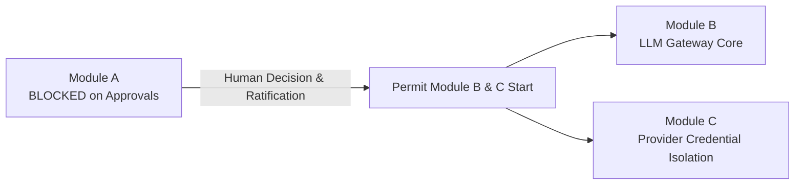

# ARKA Phase 3 — Module A Completion & Readiness Report

**Document:** `docs/security/PHASE_3_MODULE_A_READINESS_REPORT.md`  
**Classification:** Internal Security Architecture & Governance Report  
**Date:** 2026-10-25  
**Auditor / Authors:** Senior Rust Security Architect, Python AI Systems Engineer, Application Security Reviewer  
**Governing Documents:** ARKA PRD v2.2, ARKA TRD v2.2, `AGENTS.md`, `.github/CODEOWNERS`  
**Module:** Phase 3 Module A — Architecture, Contracts, and Governance Baseline  
**Module A Status:** `BLOCKED` (Design deliverables complete; awaiting human CODEOWNER decisions)  
**Execution Permission:** **MODULES B AND C ARE NOT PERMITTED TO START.**

---

## 1. Executive Summary & Readiness Decision

Module A established the foundational architecture, interface contracts, threat models, and governance gates for ARKA Phase 3 (Intelligence & Multi-Agent Plane). 

Following the non-negotiable security invariant:
$$\mathbf{DISCOVERED \neq AUTHORIZED}$$
and the defining pipeline:
$$\mathbf{LLM\ Proposes} \longrightarrow \mathbf{Rust\ Kernel\ Authorizes} \longrightarrow \mathbf{Execution\ Broker\ Executes} \longrightarrow \mathbf{Worker\ Operates} \longrightarrow \mathbf{Evidence\ Records}$$

AI agents are strictly reasoning components with zero execution authority.

### Explicit Readiness Determination:
- **Module A Status:** `BLOCKED`
- **Modules B (LLM Gateway Core) and C (Provider Credential Isolation) Permission:** **DENIED.** Modules B and C **CANNOT** start until human CODEOWNER (`@jivi001`) formally ratifies the open architecture decisions and approves the dedicated credential gate proposal.

---

## 2. Requirements Addressed in Module A

| Requirement Area | Specification & Action Taken | Deliverable Document Reference |
|---|---|---|
| **Repository Baseline Re-Audit** | Verified git branch, toolchains, Rust crates, test suites, and physical absence of Python intelligence plane or kernel IPC service binary. Reconciled D-001–D-007 register against DEC-01–DEC-14. | [`docs/security/PHASE_3_MODULE_A_BASELINE_AUDIT.md`](file:///home/exu0/cybersecurity/Programs/ARKA/docs/security/PHASE_3_MODULE_A_BASELINE_AUDIT.md) |
| **Python-to-Rust IPC Architecture** | Evaluated in-process FFI, local UDS, and network HTTP/gRPC across 10 security dimensions. Recommended local IPC over dedicated Unix domain socket (`arka-kerneld`). | [`docs/security/adr/ADR-007-PYTHON-RUST-IPC-TRANSPORT-AND-AUTHENTICATION.md`](file:///home/exu0/cybersecurity/Programs/ARKA/docs/security/adr/ADR-007-PYTHON-RUST-IPC-TRANSPORT-AND-AUTHENTICATION.md) |
| **Architecture Decision Register** | Synthesized ADR-001 through ADR-007 and evaluated unresolved decisions DEC-01 through DEC-14 blocking Phase 3. | [`docs/security/PHASE_3_MODULE_A_ARCHITECTURE_DECISIONS.md`](file:///home/exu0/cybersecurity/Programs/ARKA/docs/security/PHASE_3_MODULE_A_ARCHITECTURE_DECISIONS.md) |
| **Proposal & Wire Contracts** | Formulated strict length-prefixed JSON wire schema for action proposals, normalized canonical actions, and authorization responses. Resolved Kernel-to-Broker proof contract (DEC-10). | [`docs/security/PHASE_3_MODULE_A_CONTRACTS.md`](file:///home/exu0/cybersecurity/Programs/ARKA/docs/security/PHASE_3_MODULE_A_CONTRACTS.md) |
| **Comprehensive Threat Model** | Formulated STRIDE and OWASP Agentic/LLM threat model covering all 12 mandatory threat vectors. | [`docs/security/PHASE_3_MODULE_A_THREAT_MODEL.md`](file:///home/exu0/cybersecurity/Programs/ARKA/docs/security/PHASE_3_MODULE_A_THREAT_MODEL.md) |
| **Dedicated Acceptance Gate** | Drafted `GATE-PROVIDER-CRED-ISOLATION-001` with 7 executable test scenarios and prepared schema-compliant YAML additions for CODEOWNER review. | [`docs/security/PHASE_3_MODULE_A_ACCEPTANCE_MATRIX.md`](file:///home/exu0/cybersecurity/Programs/ARKA/docs/security/PHASE_3_MODULE_A_ACCEPTANCE_MATRIX.md) |

---

## 3. Exact Files Created in Module A

All deliverables have been authored without mutating any protected security registries or existing baselines:

1. `docs/security/PHASE_3_MODULE_A_BASELINE_AUDIT.md` (Repository re-audit, crate inventory, fact vs claim taxonomy)
2. `docs/security/adr/ADR-007-PYTHON-RUST-IPC-TRANSPORT-AND-AUTHENTICATION.md` (Proposed ADR for local UDS IPC transport)
3. `docs/security/PHASE_3_MODULE_A_ARCHITECTURE_DECISIONS.md` (ADR-001–007 synthesis and DEC-01–DEC-14 analysis)
4. `docs/security/PHASE_3_MODULE_A_CONTRACTS.md` (Wire schemas, authorization outcomes, Kernel-Broker contract, module DAG)
5. `docs/security/PHASE_3_MODULE_A_THREAT_MODEL.md` (STRIDE assessment covering all 12 threat vectors)
6. `docs/security/PHASE_3_MODULE_A_ACCEPTANCE_MATRIX.md` (Dedicated gate proposal, 7 test scenarios, YAML additions)
7. `docs/security/PHASE_3_MODULE_A_READINESS_REPORT.md` (This document)

---

## 4. Tests Executed & Actual Verification Results

| Test Suite / Command | Toolchain / Scope | Actual Result | Observations & Limitations |
|---|---|:---:|---|
| `cargo fmt --check` | Rust 1.99.0 | **PASS** | 0 formatting violations across workspace. |
| `cargo clippy --all-targets --all-features -- -D warnings` | Rust 1.99.0 | **PASS** | 0 linter warnings across all crates. `#![forbid(unsafe_code)]` active. |
| `cargo test --workspace` | Rust 1.99.0 | **PASS** | **161 passed**, 0 failed, 0 ignored. Validates Phase 1 kernel & Phase 2 broker/sandbox. |
| `python3 security/validator/validate_security_model.py` | Python 3.13.5 | **PASS** | 35 threats, 39 controls, 37 gates, 44 tests, 6 key domains. 100% referential integrity and baseline manifest verified. |
| `python3 -m unittest discover -s tests/security -v` | Python 3.13.5 | **PASS** | **22 passed**, 0 failed. Validates key provider, domain separation, and meta-validator rules. |
| Phase 3 Implementation Tests | N/A | **NOT RUN** | Phase 3 test paths are null and status is PENDING(phase=3) because implementation has not begun. |

---

## 5. Security Gate Status & Governance Evidence

| Phase / Gate | Lifecycle Status | Evidence & Warning Details |
|---|:---:|---|
| **Phase 0: Security Foundation** | `COMPLETE_WITH_WARNINGS` | Warning: `BLOCKED_EXTERNAL_CONFIGURATION` on GitHub Branch Protection manual activation (`docs/security/BRANCH_PROTECTION.md`). |
| **Phase 1: Deterministic Security Kernel** | `COMPLETE_WITH_WARNINGS` | 92 tests pass. Warning: `PENDING_FORMAL_CODEOWNER_ATTESTATION` by `@jivi001`. |
| **Phase 2: Execution Foundation & Sandboxing**| `COMPLETE_WITH_WARNINGS` | 161 tests pass. Warning 1: `PENDING_FORMAL_CODEOWNER_ATTESTATION` by `@jivi001`. Warning 2: `PRODUCTION_EXECUTION_DISABLED` (Dry-run only). |
| **Phase 3: Intelligence & Multi-Agent Plane** | `NOT_STARTED` | Awaiting Module A ratifications and formal commencement. |
| **`GATE-PROVIDER-CRED-ISOLATION-001`** | `PROPOSED` | Drafted with 7 mandatory executable test scenarios. Awaiting CODEOWNER integration. |

---

## 6. Blockers & Residual Risks

1. **Absence of Kernel Service Binary:** Until `crates/arka-kerneld` is authorized and created, no communication path exists between Python and the Rust kernel.
2. **Pending CODEOWNER Sign-Off:** Phase 1 and Phase 2 releases remain un-attested by `@jivi001`.
3. **Open Decisions in Decision Register:** Decisions `DEC-01` (Gateway OS boundary), `DEC-03` (RFC 8785 JCS compatibility), `DEC-04` (A2A key domain), and `DEC-10` (Kernel-to-Broker proof) represent foundational architectural choices that must not be unilaterally decided by automated systems.
4. **Dry-Run Broker:** Production target-facing execution is intentionally disabled in the broker and must remain disabled.

---

## 7. Required Human Decisions from `@jivi001`

To unblock Phase 3 and authorize commencement of Modules B and C, the human CODEOWNER (`@jivi001`) must:

1. **Ratify ADR-007:** Approve the dedicated `arka-kerneld` service daemon and local Unix domain socket (`/run/arka/kernel.sock`) with `SO_PEERCRED` and Ed25519 authentication.
2. **Ratify ADR-004:** Formally approve the separate-process boundary for `arka-gatewayd` and reject shared-UID / in-agent secret co-location.
3. **Ratify ADR-005 & ADR-006:** Approve the A2A wire contract and RFC 8785 JSON Canonicalization standard.
4. **Approve Dedicated Gate Proposal:** Approve the integration of `GATE-PROVIDER-CRED-ISOLATION-001` and `THREAT-PROVIDER-CRED-THEFT` into `/security/` registries.
5. **Decide Open Register Entries:** Resolve decisions `DEC-01` through `DEC-14` in `docs/security/PHASE_3.1C_DECISION_REGISTER.md`.
6. **Formally Attest Phases 1 & 2:** Sign off on release attestations in `security/acceptance/phase-status.yaml`.

---

## 8. Next Permitted Module and Prerequisites

- **Current State:** Module A design complete; awaiting human review.
- **Next Permitted Modules:** **Module B (LLM Gateway Core)** and **Module C (Provider Credential Isolation)**.
- **Mandatory Prerequisite:** Formal human ratification of ADR-004, ADR-007, and approval of `GATE-PROVIDER-CRED-ISOLATION-001`. Zero Module B or C code may be written until these approvals are recorded.
