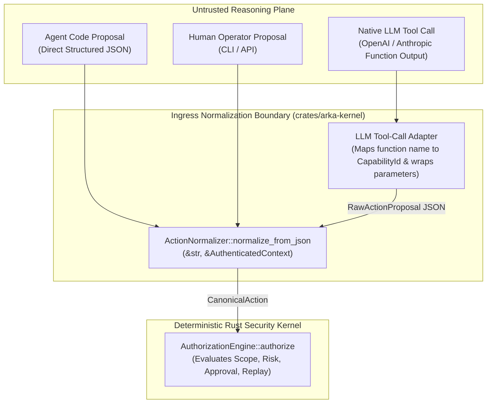

# ADR-006: Single Action Normalization Boundary, RFC 8785 JCS Canonicalization, and LLM Tool-Call Mediation

**Status:** PROPOSED (Pending Human Ratification by `@jivi001`)  
**Date:** 2026-10-18  
**Authors:** Principal AI Security Architect, Rust/Python Systems Engineer  
**Phase:** Phase 3 — Intelligence & Multi-Agent Plane  
**Classification:** Security-Critical Architectural Contract  

---

## 1. Context and Problem Statement

ARKA combines AI-assisted reasoning with deterministic execution controls. In Phase 3, autonomous agents formulate action proposals either through explicit structured message formulation or via native Large Language Model (LLM) tool-calling interfaces (e.g., OpenAI function calls, Anthropic tool use).

Allowing multiple parsing or dispatch paths for action execution introduces catastrophic security vulnerabilities, including parser differentials, semantic parameter drift, and TOCTOU authorization bypasses. These risks are bounded by foundational operating invariants:

$$\mathbf{INV-001:}\quad \text{The LLM plane has zero direct operating system, shell, socket, or network execution authority.}$$

$$\mathbf{INV-005:}\quad \text{Approval MUST bind to a canonical hash of the complete normalized action parameters. Any parameter mutation invalidates approval.}$$

$$\mathbf{INV-008:}\quad \text{Every external side effect MUST flow through the Rust Execution Broker.}$$

$$\mathbf{INV-009:}\quad \text{No component outside the Execution Broker may possess an execution capability capable of independently producing side effects.}$$

$$\mathbf{TRD\ \S7:}\quad \text{All action proposals, LLM tool calls, and human-triggered actions MUST enter exactly one function: } \texttt{normalize\_action(input)} \to \text{CanonicalAction.}$$

$$\mathbf{DISCOVERED \neq AUTHORIZED}$$

ARKA requires an authoritative specification confirming the canonicalization standard, establishing cross-language determinism between Python and Rust, and guaranteeing that native LLM tool calls cannot establish an out-of-band execution bypass.

---

## 2. Verified Baseline: Rust Kernel Normalization Implementation

The deterministic Rust Security Kernel currently provides the authoritative reference implementation of the normalization boundary in `crates/arka-kernel/src/actions/normalizer.rs`:

```text
[ Raw Untrusted Action Proposal JSON ]
                   │
                   ▼
       [ StrictJsonParser::parse ]
       ├── Enforces <= 64KB payload limit
       ├── Enforces <= 8 nesting depth limit
       └── Rejects duplicate JSON keys (preventing parser differentials)
                   │
                   ▼
     [ RawActionProposal Deserialization ]
       ├── #[serde(deny_unknown_fields)]
       └── Validates proposal_id, mission_id, capability_id, target, parameters, nonce
                   │
                   ▼
    [ ActionNormalizer::normalize_proposal ]
       ├── Asserts proposal.mission_id == context.mission_id (INV-004)
       ├── Resolves Capability metadata from authoritative CapabilityRegistry
       ├── Verifies AuthenticatedContext possesses requested capability
       ├── Enforces Risk Derivation: untrusted declared_risk mismatch triggers DENY (INV-005)
       ├── Normalizes Target via TargetParser::parse (canonical IP/CIDR/Domain)
       ├── Canonicalizes Parameters via RFC 8785 JCS (canonicalize_json)
       ├── Computes parameter_hash = SHA256("ARKA-PARAM-V1:" || JCS(parameters))
       ├── Generates deterministic ActionId = "act_" || proposal_id
       └── Computes action_hash = SHA256("ARKA-ACTION-V1:" || JCS({
               action_id, capability_id, mission_id, nonce, parameter_hash, policy_version, target
           }))
                   │
                   ▼
         [ CanonicalAction ]  (Immutable, Authoritative Security Record)
```

---

## 3. Canonicalization Scheme Comparison

Three serialization and canonicalization formats were evaluated against ARKA's cross-language, cryptographic, and auditing requirements:

| Evaluation Criteria | RFC 8785 JSON Canonicalization Scheme (JCS) | Deterministic CBOR (RFC 8949 dCBOR) | Google Protocol Buffers (Deterministic) |
|---|---|---|---|
| **Human Auditability & Readability** | **Highest:** Canonical JSON is plain text; rendered directly in SQLite audit logs and operator approval screens without transcoding. | Low: Binary format; requires external tooling to inspect raw audit bytes. | Low: Binary format; requires `.proto` schema descriptors to decode. |
| **Numeric Representation Determinism** | **Standardized:** Uses ECMAScript IEEE 754 formatting rules (no exponential notation for standard ranges, strict zero representation). | Strong: Strict integer size rules and minimal float representation. | Moderate: Schema-dependent; varint and float representation differences. |
| **Object Key Ordering** | **Strict:** Lexicographical ordering by UTF-16 code units (byte ordering matches in UTF-8). | Strict: Key sorting by byte length then value. | Strict: Field tag numbering order. |
| **Cross-Language Support (Rust & Python)** | **High:** Implemented in Rust (`crates/arka-crypto/src/canonical.rs`); standard libraries exist in Python (`canonicaljson`). | Moderate: Requires specialized CBOR libraries in both languages; edge cases in map ordering. | High: Official compilers, but rigid build-time code generation required. |
| **Dynamic Tool Parameter Flexibility** | **High:** Arbitrary structured JSON objects validated dynamically against capability schemas. | High: Schema-free maps. | **Poor:** Dynamic JSON requires `google.protobuf.Struct`, which has ambiguous canonicalization. |

### 3.1 Architectural Conclusion on Canonicalization

> [!IMPORTANT]
> **Decision:** We reaffirm **RFC 8785 (JCS)** as the authoritative canonicalization scheme for ARKA action proposals and parameter hashing.
> 
> **Python Integration Requirement:** The Phase 3 Python plane (`arka/core/crypto/`) must incorporate a certified RFC 8785 canonicalization implementation verified against cross-language test vectors to guarantee that hashes computed in Python match hashes computed in Rust byte-for-byte.

---

## 4. Single Authoritative Normalization Contract

To prevent parallel authorization pathways, the architecture mandates that **native LLM tool calls and agent proposals merge into an identical, unified normalization pipeline**.



### 4.1 Native LLM Tool-Call Adapter Specification

When an LLM returns a native tool call (e.g., `{"name": "execute_port_scan", "arguments": "{\"target\": \"192.168.1.5\", \"ports\": [80, 443]}"}`), the agent plane must not attempt to execute or dispatch the call. Instead, it must route through an in-memory adapter that:

1. **Maps Tool Name to Capability:** Matches the function name against registered capabilities (e.g., `execute_port_scan` $\to$ `CapabilityId("PORT_SCAN")`). If unknown, the proposal is rejected before ingestion.
2. **Generates Invariant Envelope:** Assembles a `RawActionProposal`:
   ```json
   {
     "proposal_id": "prop_01J9Y75A1B2C3D4E5F6G7H8J9K",
     "mission_id": "<authenticated_agent_mission_id>",
     "parent_task_id": "<active_task_id>",
     "capability_id": "PORT_SCAN",
     "target": "192.168.1.5",
     "parameters": {
       "ports": [80, 443]
     },
     "nonce": "<cryptographic_random_128bit_hex>"
   }
   ```
3. **Submits to Kernel:** Passes the raw serialized JSON to `ActionNormalizer::normalize_from_json`.
4. **Rejection of Unknown Fields:** If the LLM generates hallucinated envelope attributes or unpermitted parameters, deserialization fails closed under `#[serde(deny_unknown_fields)]`.

---

## 5. Non-Claims & Verification Prerequisites

- **No Premature Implementation Claim:** This document specifies the architectural contract. No claims are made that cross-language canonicalization is active until Phase 3.1c delivers:
  1. `test_cross_language_jcs_parity`: 100 identical JSON test vectors canonicalized in both Python and Rust yield identical SHA-256 hashes.
  2. `test_llm_tool_call_strict_envelope_rejection`: Ingestion of malformed or extra-field tool calls fails closed.
  3. `test_duplicate_key_rejection_in_tool_args`: Tool arguments with duplicate keys are blocked by `StrictJsonParser`.

---

## 6. Decision Status & Human Sign-Off Requirement

**Decision Status:** `PROPOSED / PENDING HUMAN DECISION`  
**Required Approver:** Principal Systems Architect & Human CODEOWNER (`@jivi001`)  
**Recommended Action:** Formally ratify RFC 8785 JCS as the sole canonicalization standard and mandate the LLM Tool-Call Adapter pattern for Phase 3.1c.
