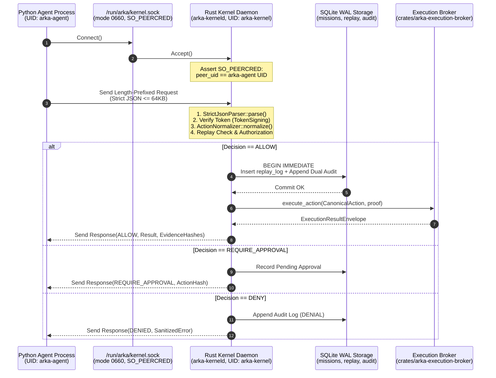

# ADR-007: Python-to-Rust Local IPC Transport, Service Boundary, and Mutual Authentication Contract

**Status:** PROPOSED (Pending Human Ratification by `@jivi001`)  
**Date:** 2026-10-25  
**Authors:** Senior Rust Security Architect, Python AI Systems Engineer, Application Security Reviewer  
**Phase:** Phase 3 — Intelligence & Multi-Agent Plane (Module A)  
**Classification:** Security-Critical Architectural Contract  
**Decision Authority:** Human Security Architecture Owner & CODEOWNER (`@jivi001`)  
**Related Documents:** ARKA PRD v2.2, ARKA TRD v2.2, `AGENTS.md`, `ADR-004`, `ADR-005`, `ADR-006`, `PHASE_3.1C_DECISION_REGISTER.md` (DEC-01, DEC-10)

---

## 1. Context and Problem Statement

ARKA Phase 3 introduces the Python Intelligence Plane, comprising autonomous agent reasoning loops (Orchestrator, Reconnaissance, Vulnerability Analysis, Exploitation Validation, Reporting) and an isolated LLM Gateway. 

Under the ARKA architecture, autonomous agents have **zero direct execution authority**:
$$\mathbf{INV-001:}\quad \text{The LLM plane has zero direct operating system, shell, socket, or network execution authority.}$$
$$\mathbf{INV-004:}\quad \text{An action's authority and identity come strictly from an AuthenticatedContext, never untrusted input.}$$
$$\mathbf{INV-008:}\quad \text{Every external side effect MUST flow through the Rust Execution Broker.}$$
$$\mathbf{DISCOVERED \neq AUTHORIZED}$$

Every action an agent wishes to perform must be submitted as an untrusted `RawActionProposal` to the Rust Security Kernel for canonical normalization and deterministic policy authorization.

However, the baseline audit reveals that the Rust Security Kernel (`crates/arka-kernel`) is currently an in-process library crate with **no external IPC interface, daemon binary, or network endpoint**. Python code cannot invoke Rust kernel authorization functions without an approved communication boundary.

Furthermore, a communication mechanism between Python and Rust is not merely a data serialization choice; it is a **primary security boundary**. If designed incorrectly, it can allow compromised agents to read kernel memory, bypass authorization checks, forge caller identities, or crash the security kernel.

---

## 2. Evaluation of Communication Architecture Alternatives

Three architectural alternatives were evaluated across ten security and operational criteria:

```text
Alternative 1: In-Process FFI (PyO3 / C-FFI / ctypes)
+-------------------------------------------------------+
|  Single OS Process (Python Interpreter + Rust Kernel)  |
|  - Virtual address space shared between Python & Rust |
|  - Memory inspection: Python ctypes can read Rust heap|
|  - Process crash in Python crashes the Security Kernel|
+-------------------------------------------------------+

Alternative 2: Local IPC via Dedicated Unix Domain Socket (UDS) [RECOMMENDED]
+-----------------------------------+         +------------------------------------+
|  Agent Process (UID: arka-agent)  |         | Kernel Service (UID: arka-kernel)  |
|  - Python Agent Runtime           |         | - Standalone daemon (arka-kerneld) |
|  - Zero kernel memory access      |         | - Owns SQLite WAL storage          |
|  - Zero broker execution access   |         | - Authoritative policy & replay    |
+-----------------+-----------------+         +-----------------+------------------+
                  |                                             ^
                  |===== Authenticated UDS (SO_PEERCRED) =======|
                         (/run/arka/kernel.sock, mode 0660)

Alternative 3: Network Service (Localhost HTTP/1.1 or gRPC over TCP)
+-----------------------------------+         +------------------------------------+
|  Agent Process                    |         | Kernel HTTP/gRPC Service           |
|  - HTTP / gRPC client             |         | - TCP socket on 127.0.0.1:port     |
|  - Subject to loopback routing    |         | - Complex TLS/mTLS configuration   |
+-----------------+-----------------+         +-----------------+------------------+
                  |                                             ^
                  |============ TCP Loopback Connection ========|
```

### 2.1 Comparative Analysis Matrix

| Evaluation Dimension | Option 1: In-Process FFI (PyO3) | Option 2: Local IPC via UDS (`arka-kerneld`) [RECOMMENDED] | Option 3: Local Network Service (HTTP/gRPC) |
|---|---|---|---|
| **1. Process & Privilege Separation** | **CRITICAL FAILURE:** Shared address space. A compromised agent can use `ctypes` or arbitrary memory reads to inspect SQLite encryption keys, token signing keys, or mutate kernel memory structs directly. | **MAXIMUM:** Strict OS process boundary. Python agents run under distinct unprivileged UID (`arka-agent`); kernel runs as `arka-kernel`. Discretionary Access Control (DAC) prevents memory and proc inspection. | **MODERATE:** Process boundary exists, but exposed on network stack. Subject to port collision, port scanning, and loopback hijacking. |
| **2. Authentication & Caller Identity** | **NONE:** Python passes struct pointers into Rust. Identity spoofing is trivial via memory tampering or argument fabrication. | **DETERMINISTIC:** Two-layer authentication: (a) OS-level `SO_PEERCRED` verifies caller UID/GID at socket level; (b) Cryptographic Ed25519 token signed under `KeyDomain::TokenSigning` verified on every request. | **MODERATE:** Requires application-layer mTLS or Bearer tokens. Vulnerable to token leakage if loopback traffic is intercepted by other local users. |
| **3. Mission & Request Binding** | Weak: In-memory references can be cross-pollinated across agent threads. | **STRICT:** Every wire request carries an immutable cryptographic `TokenId` and `MissionId`. Kernel validates that token matches the active mission state in SQLite before evaluating proposal. | Moderate: Handled via HTTP request headers. |
| **4. Socket Ownership & Permissions** | N/A (no socket). | **HARDENED:** Socket file `/run/arka/kernel.sock` created with permissions `0660`, owned by `arka-kernel:arka-agent`. Only authorized agent processes in the `arka-agent` group can connect. Directory `/run/arka` is `0750`. | **WEAK:** Any local process on the machine capable of connecting to `127.0.0.1:port` can probe the service. |
| **5. Request Validation & Replay Resistance** | Vulnerable to memory-corruption attacks and deserialization bypasses. | **MAXIMAL:** Untrusted bytes ingested via `StrictJsonParser` (<=64KB, depth <=8, duplicate keys rejected). Replay log enforced via atomic SQLite `BEGIN IMMEDIATE` check-and-consume. | Good, but HTTP parser overhead and potential HTTP request smuggling or header injection risks. |
| **6. Service Lifecycle & Failure Handling** | **CATASTROPHIC:** A segmentation fault, unhandled panic, or memory exhaustion in Python kills the entire kernel, destroying in-flight audit trails. | **ISOLATED:** Agent crashes or panics have zero impact on `arka-kerneld`. Kernel daemon manages SQLite WAL lifecycle cleanly, implements graceful SIGTERM draining, and fails closed. | Isolated, but complex gRPC connection retry and reconnect semantics required. |
| **7. Auditability** | Difficult to guarantee independent audit logging when caller and auditor share memory. | **DETERMINISTIC:** Kernel daemon signs both System and Mission audit logs under `KeyDomain::AuditSigning` immediately upon decision commit. Agent has no ability to alter audit trail. | Good: Can record audit events on request receipt. |
| **8. Kernel & Broker Compatibility** | High (in-process calls), but destroys the execution isolation model. | **PERFECT ALIGNMENT:** Kernel remains the authoritative gatekeeper. Broker is held behind the kernel service, preventing any direct agent-to-broker reachability (resolving DEC-10). | Requires bridging network RPC to broker crate. |
| **9. Operational Complexity** | Low deployment overhead, but extreme development complexity in debugging cross-language FFI crashes and memory safety. | **MODERATE:** Requires creating a dedicated binary crate (`crates/arka-kerneld`), systemd service unit / process supervisor, and lightweight UDS client in Python. | **HIGH:** Requires managing TLS certificates, ports, HTTP/2 multiplexing, proto compilation, and gRPC dependencies. |
| **10. Testability of Security Boundary** | Poor: Cannot simulate OS-level privilege separation or process compromise in unit tests. | **EXCELLENT:** Easily testable via standard integration tests using temporary Unix sockets, mock peer credentials, and client subprocesses. | Good, but requires socket port binding and network fixtures. |

---

## 3. Decision

We propose **Option 2: Local IPC via a Dedicated Unix Domain Socket with a Standalone Rust Kernel Service Daemon (`arka-kerneld`)** as the formal architectural candidate for ARKA Phase 3.

### 3.1 Decision Principles

1. **Physical Process Isolation:** The Python Intelligence Plane and the Rust Security Kernel MUST execute in distinct OS processes under distinct Linux UIDs:
   - `arka-agent`: Executes Python agent reasoning loops and LLM Gateway.
   - `arka-kernel`: Executes `arka-kerneld`, holds SQLite WAL files, and accesses cryptographic audit signing keys.
2. **Deterministic Kernel Superiority:** `arka-kerneld` is the sole authority managing `crates/arka-kernel`, `crates/arka-storage-sqlite`, and `crates/arka-execution-broker`. Python agents NEVER have direct socket or IPC reachability to the Execution Broker.
3. **Defense-in-Depth Authentication:** A Unix domain socket alone does not provide sufficient security. IPC security is enforced through a strict three-barrier defense:
   - **Barrier 1 (OS DAC):** Directory permissions (`/run/arka`: `0750`, owned by `arka-kernel:arka-security`) and socket permissions (`/run/arka/kernel.sock`: `0660`, owned by `arka-kernel:arka-agent`).
   - **Barrier 2 (Kernel Peer Credential Assertion):** `arka-kerneld` inspects `SO_PEERCRED` on every `accept()` call to verify caller UID and GID.
   - **Barrier 3 (Cryptographic Token Verification):** Every request payload must supply a valid, unexpired Ed25519 authentication token signed under `KeyDomain::TokenSigning`.

---

## 4. Technical Specification: Kernel IPC Architecture



### 4.1 Wire Protocol & Message Framing

To prevent parser differentials, packet fragmentation vulnerabilities, and resource exhaustion:
1. **Framing:** Length-prefixed framing. Every frame begins with a 4-byte big-endian unsigned integer (`u32`) specifying the length of the JSON payload.
2. **Payload Size Bound:** The maximum permitted payload length is **65,536 bytes (64 KB)**. If the length header exceeds 65,536 bytes, `arka-kerneld` immediately terminates the connection without reading the body.
3. **Format:** UTF-8 encoded JSON adhering to RFC 8259, parsed exclusively through `StrictJsonParser` (rejecting depth > 8 and duplicate keys).
4. **RPC Model:** Strictly synchronous or multiplexed request-response over persistent connection.

### 4.2 Request Envelope Schema

```json
{
  "$schema": "https://arka.security/schemas/v1/kernel-request.json",
  "request_id": "req_01J9Y78B9X4A5C6D7E8F9G0H1J",
  "client_version": "3.0.0",
  "auth_token": "eyJhbGciOiJFZERTQ...",
  "operation": "AUTHORIZE_AND_EXECUTE",
  "proposal": {
    "proposal_id": "prp_01J9Y70A1B2C3D4E5F6G7H8J9K",
    "mission_id": "mis_01J9Y70X9Y8Z7W6V5U4T3S2R1Q",
    "parent_task_id": "tsk_01J9Y71M2N3P4Q5R6S7T8U9V0W",
    "capability_id": "PORT_SCAN",
    "target": "192.0.2.1",
    "parameters": {
      "ports": [80, 443],
      "timing": 3
    },
    "nonce": "c4b3a291f8e7d6c5b4a3928170e6f5d4"
  }
}
```

### 4.3 Response Envelope Schema

```json
{
  "$schema": "https://arka.security/schemas/v1/kernel-response.json",
  "request_id": "req_01J9Y78B9X4A5C6D7E8F9G0H1J",
  "decision": "ALLOW",
  "action_id": "act_01J9Y72A3B4C5D6E7F8G9H0J1K",
  "action_hash": "e3b0c44298fc1c149afbf4c8996fb92427ae41e4649b934ca495991b7852b855",
  "execution_result": {
    "state": "COMPLETED",
    "evidence_hashes": [
      "sha256:d41d8cd98f00b204e9800998ecf8427e"
    ],
    "execution_id": "exc_01J9Y73X4Y5Z6W7V8U9T0S1R2Q"
  },
  "error": null
}
```

---

## 5. Security Invariants & Fail-Closed Controls

1. **Fail-Closed on Socket Failure:** If `/run/arka/kernel.sock` is unavailable, permissions are incorrect, or the daemon is restarting, Python agents must abort the proposed task immediately. No fallback to local execution, mock authorization, or direct worker dispatch is permitted.
2. **Replay Rejection:** The `nonce` in the proposal is combined with `mission_id` and hashed under `DOMAIN_REPLAY`. It is checked and inserted atomically within a SQLite transaction. Replayed nonces return `REPLAY_DETECTED` and are logged as security events.
3. **Monotonic Emergency Stop:** `arka-kerneld` checks the emergency stop table in SQLite before evaluating any proposal. If an emergency stop is active for the mission or globally, the proposal is denied instantly (`EMERGENCY_STOP_ACTIVE`).
4. **Kernel-to-Broker Single Authority (Addressing DEC-10):** The Execution Broker instance is instantiated inside `arka-kerneld` and is inaccessible via any public socket. Only `arka-kerneld`'s internal dispatch pipeline invokes `broker.execute_action()`, ensuring that no unauthorized `CanonicalAction` can ever reach the broker.

---

## 6. Required Implementation Controls

To implement this decision upon formal approval:
1. **New Rust Binary Crate:** Create `crates/arka-kerneld` in the Cargo workspace with `#![forbid(unsafe_code)]`.
2. **Socket Management:** Use `tokio::net::UnixListener` with `libc::chmod` and `libc::chown` immediately after socket bind, or systemd socket activation.
3. **Peer Credential Inspection:** Call `socket.peer_cred()` via `tokio::net::UnixStream` (using `tokio::net::unix::UCred` / `getsockopt(SO_PEERCRED)`).
4. **Signal Handling:** Handle `SIGINT` and `SIGTERM` to perform graceful connection draining and socket file unlinking.
5. **Python Client Library:** Implement `arka.bridge.kernel_client.KernelClient` with connection pooling, framing, timeout handling, and automatic fail-closed semantics.

---

## 7. Acceptance Test Plan

| Test ID | Test Scenario | Expected Property |
|---|---|---|
| `TEST-IPC-AUTH-001` | Connection from unauthorized UID / GID | `arka-kerneld` rejects connection at `SO_PEERCRED` check with `ConnectionReset`. |
| `TEST-IPC-FRAME-001` | Payload exceeding 65,536 bytes | Daemon aborts connection without allocating buffer; logs `PAYLOAD_LIMIT_EXCEEDED`. |
| `TEST-IPC-JSON-001` | Malformed JSON or duplicate keys | `StrictJsonParser` rejects request; returns `INVALID_JSON_PAYLOAD`. |
| `TEST-IPC-TOKEN-001` | Missing, expired, or forged Ed25519 token | Token verification fails; returns `UNAUTHORIZED_TOKEN`. |
| `TEST-IPC-REPLAY-001` | Duplicate request with identical nonce | Replay detected; returns `REPLAY_DETECTED`; second execution denied. |
| `TEST-IPC-ESTOP-001` | Proposal submitted while E-Stop active | Authorization fails immediately with `EMERGENCY_STOP_ACTIVE`. |
| `TEST-IPC-ISOLATION-001` | Agent attempts direct connection to Broker | Broker has no external socket; agent connection refused. |

---

## 8. Status, Approval, and Consequences of Deferral

- **Status:** `PROPOSED`  
- **Decision Owner:** `@jivi001` (Human Security Architecture Owner)  
- **Consequences of Deferral:** Phase 3 Module G (Action Normalization & Rust Kernel Bridge) and all live agent-to-kernel operations remain completely blocked. Python agents cannot execute authorized actions.
- **Immediate Requirement:** Formal human review and sign-off by `@jivi001` before `crates/arka-kerneld` implementation begins.
